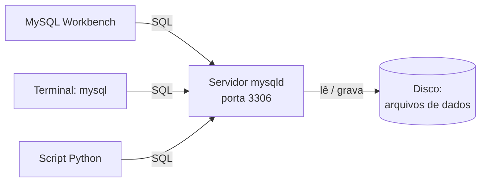
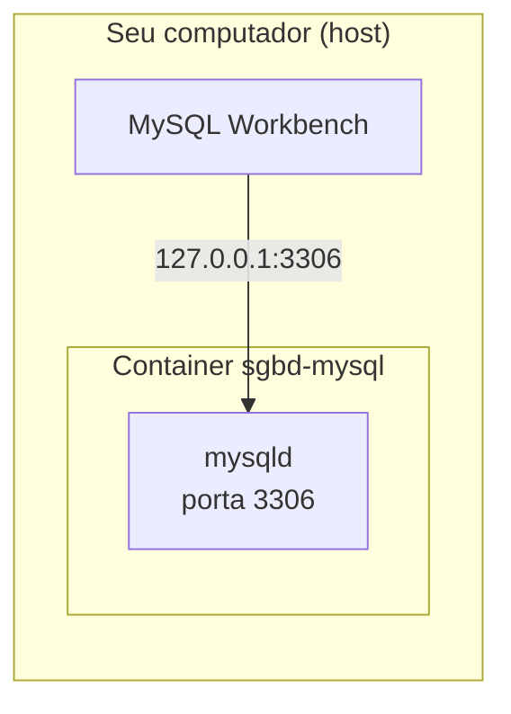
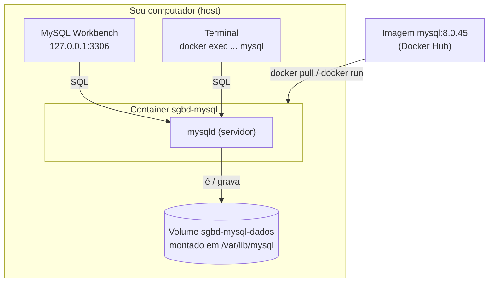
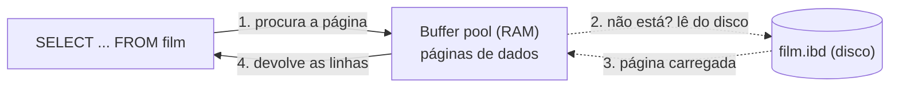

# MySQL: Fundamentos

| Etapa | Arquivo | Tema |
|-------|---------|------|
| **0** | **[my_sql_basics.md](my_sql_basics.md)** | **Fundamentos: banco, SGBD, cliente/servidor, ambiente com Docker e primeira conexão ← você está aqui** |
| 1 | [sql_comandos_1.md](sql_comandos_1.md) | Carregar o Sakila; investigar estruturas; criar, alterar e remover tabelas; inserir e editar dados |
| 2 | [sql_comandos_2.md](sql_comandos_2.md) | Consultas em uma tabela: `SELECT`, `DISTINCT`, `WHERE`, `LIKE`, `ORDER BY`, `LIMIT` |
| 3 | [sql_comandos_3.md](sql_comandos_3.md) | Agregações: `COUNT`, `SUM`, `AVG`, `MIN`, `MAX`, `GROUP BY`, `HAVING` |
| 4 | [sql_comandos_4.md](sql_comandos_4.md) | Combinar tabelas: `INNER`, `LEFT`, `RIGHT` e `CROSS JOIN`, multiplicidade, `FULL` simulado |

> **Contrato deste arquivo**
>
> * **Objetivo:** ter um servidor MySQL funcionando e saber conversar com ele.
> * **Conhecimentos prévios:** usar um terminal (abrir, digitar um comando, ler a resposta).
> * **Estado inicial:** Docker instalado; nenhum servidor MySQL preparado para o curso.
> * **Ao final, você conseguirá:** (1) distinguir banco de dados, SGBD, cliente e servidor; (2) subir o MySQL em um container e confirmar que ele aceita conexões; (3) conectar-se pelo terminal e pelo Workbench e executar `SELECT VERSION();`; (4) explicar o que acontece com os dados ao parar ou remover o container.
> * **Próximo passo:** [nível 1](sql_comandos_1.md), que carrega o banco de estudo Sakila.

> **Como ler os blocos de código (vale para todos os arquivos)**
>
> * **▶ Executar** — faz parte do roteiro; execute na ordem em que aparece.
> * **✖ Erro intencional** — deve falhar; serve para conhecer a mensagem. Não altera os dados (pode, no máximo, consumir um número de `AUTO_INCREMENT`).
> * **◇ Ilustrativo** — não execute; mostra uma ideia, um formato ou um trecho incompleto.
> * Blocos sem rótulo, em texto simples, são **saídas**. "Saída ilustrativa" indica que detalhes (datas, IDs, tempos) podem variar.
>
> Cada bloco também indica **onde** executar: **no terminal do host** (seu computador), **dentro do container** (`bash-5.1#`) ou **no cliente MySQL** (`mysql>` ou Workbench).

> **Ambiente de referência:** imagem Docker oficial `mysql:8.0.45`. Os comandos de terminal foram escritos para **bash** (Linux, macOS ou WSL no Windows). As saídas mostradas foram obtidas nesse ambiente.

---

## 1. Problema

Imagine que uma loja registra suas vendas em um arquivo de texto, `vendas.csv`:

```text
venda,estado,valor
1,SP,100
2,RJ,80
3,SP,50
4,RJ,20
5,MG,70
6,SP,30
```

Com seis linhas, tudo funciona. Agora imagine milhões de vendas e dezenas de pessoas usando esse arquivo ao mesmo tempo. Surgem perguntas difíceis:

* **Concorrência:** e se dois vendedores salvarem o arquivo no mesmo instante? Qual versão vale?
* **Integridade:** o que impede alguém de digitar `valor = "cem"` ou um estado `XX`?
* **Desempenho:** para achar as vendas de MG, é preciso ler o arquivo inteiro, linha por linha?
* **Falhas:** se a energia cair no meio de uma gravação, o arquivo fica corrompido?
* **Segurança:** como permitir que o caixa registre vendas, mas não apague o histórico?

> Guardar dados é fácil. Difícil é guardá-los de forma **segura, consistente, rápida e compartilhada**. É para isso que existem os bancos de dados.

---

## 2. Banco de dados e SGBD

### 2.1 Definições

| Termo | Definição | No exemplo |
|-------|-----------|------------|
| Dado | Um valor isolado | `100`, `"SP"` |
| Banco de dados | Conjunto organizado de dados relacionados | Todas as vendas da loja |
| SGBD (Sistema Gerenciador de Banco de Dados) | Software que armazena, protege e consulta os dados | MySQL, PostgreSQL, SQL Server, Oracle |

> O banco de dados é o **conteúdo**; o SGBD é o **software** que cuida dele.

Analogia: uma biblioteca. Os livros são os dados, o acervo é o banco de dados e o bibliotecário é o SGBD. Você não entra nas estantes e pega o livro sozinho: pede ao bibliotecário, que sabe onde está, controla quem pode pegar e registra os empréstimos.

### 2.2 Banco de dados relacional

O MySQL é um SGBD **relacional**: os dados ficam organizados em **tabelas** que se relacionam entre si.

| Conceito | Significado | No exemplo |
|----------|-------------|------------|
| Tabela | Conjunto de registros do mesmo tipo | `vendas` |
| Linha (registro) | Um item da tabela | A venda 1 |
| Coluna (atributo, campo) | Uma característica, com nome e tipo | `valor INT` |
| Chave primária (PK) | Coluna que identifica cada linha de forma única | `venda` |
| Chave estrangeira (FK) | Coluna cujo valor precisa existir na chave de outra tabela | `vendas.estado` → `estados.sigla` |

As tabelas abaixo são **ilustrativas**: não há script para criá-las. Elas servem apenas para explicar os conceitos.

**Tabela `estados`**

| sigla (PK) | nome           |
|------------|----------------|
| SP         | São Paulo      |
| RJ         | Rio de Janeiro |
| MG         | Minas Gerais   |

**Tabela `vendas`**

| venda (PK) | estado (FK) | valor |
|------------|-------------|-------|
| 1          | SP          | 100   |
| 2          | RJ          | 80    |
| 3          | SP          | 50    |

Com a chave estrangeira declarada, o SGBD **recusa** uma venda com estado `XX`, porque ele não existe em `estados`.

### 2.3 SQL

**SQL** (Structured Query Language) é a linguagem usada para conversar com o SGBD. Você diz **o que** quer; o SGBD decide **como** buscar.

| Categoria | Para quê | Comandos |
|-----------|----------|----------|
| DDL (Definição) | Criar e alterar estruturas | `CREATE`, `ALTER`, `DROP` |
| DML (Manipulação) | Inserir, alterar e remover dados | `INSERT`, `UPDATE`, `DELETE` |
| DQL (Consulta) | Ler dados | `SELECT` |
| DCL (Controle) | Gerenciar permissões | `GRANT`, `REVOKE` |
| TCL (Transações) | Confirmar ou desfazer operações | `START TRANSACTION`, `COMMIT`, `ROLLBACK` |

Uma consulta simples sobre as tabelas ilustrativas: quais vendas foram feitas em SP?

**◇ Ilustrativo** (as tabelas não existem no servidor)

```sql
SELECT venda, valor
FROM vendas
WHERE estado = 'SP';
```

```text
+-------+-------+
| venda | valor |
+-------+-------+
|     1 |   100 |
|     3 |    50 |
+-------+-------+
```

Leia como uma frase: "selecione `venda` e `valor` da tabela `vendas` onde o estado é SP". A sintaxe completa é o assunto do [nível 2](sql_comandos_2.md). Perguntas de resumo, como "quanto foi vendido por estado?", usam `SUM` e `GROUP BY`, do [nível 3](sql_comandos_3.md).

### 2.4 Como o SGBD responde às dificuldades do CSV

| Dificuldade | Resposta do SGBD | Onde aparece no curso |
|-------------|------------------|-----------------------|
| Concorrência | Um servidor central coordena todos os acessos; transações isolam alterações simultâneas | Seções 3 e 4 deste arquivo |
| Integridade | Tipos de dados e restrições (chave primária, chave estrangeira, `CHECK`) recusam dados inválidos | Nível 1 |
| Desempenho | Índices e cache de páginas em memória evitam ler tudo do disco | Aprofundamento deste arquivo |
| Falhas | Transações e registros de recuperação (*redo log*) | Seção 4 e aprofundamento |
| Segurança | Usuários e permissões (`GRANT`) | Fora do escopo deste curso introdutório |

### 2.5 Das vendas à locadora

A loja de vendas serviu para apresentar os conceitos. A partir do nível 1, o curso usa um banco **real e já pronto**, o **Sakila**: uma locadora de DVDs com filmes, atores, clientes, aluguéis e pagamentos. Os mesmos conceitos (tabelas, chaves, restrições) aparecem lá, em escala maior.

> **✅ Verifique**
>
> 1. O MySQL é um banco de dados ou um SGBD?
> 2. Em `vendas.estado → estados.sigla`, qual é a chave estrangeira?
>
> *Respostas:* (1) SGBD: é o software; o banco é o conteúdo. (2) `vendas.estado`.

---

## 3. Modelo cliente-servidor

### 3.1 Definição

O MySQL funciona no modelo **cliente-servidor**:

* O **servidor** é um programa que fica rodando o tempo todo, esperando pedidos. No MySQL, ele se chama `mysqld` (o "d" vem de *daemon*, um processo que roda em segundo plano).
* O **cliente** é qualquer programa que se conecta ao servidor, envia comandos SQL e recebe respostas.

| Programa | Papel |
|----------|-------|
| `mysqld` (MySQL Server) | Servidor: guarda os dados e executa as consultas |
| `mysql` (terminal) | Cliente de linha de comando |
| MySQL Workbench | Cliente com interface gráfica |
| Script Python (`mysql-connector`, `SQLAlchemy`) | Cliente dentro de uma aplicação |

> O cliente **não** acessa os arquivos do banco diretamente. Ele sempre pede ao servidor, que lê ou grava no disco.



### 3.2 Como um cliente encontra o servidor

Para se conectar, o cliente precisa de quatro informações:

| Informação | Significado | Exemplo |
|------------|-------------|---------|
| Host | Endereço da máquina onde o servidor está | `127.0.0.1` (a própria máquina) |
| Porta | "Porta de entrada" do programa naquela máquina | `3306` (padrão do MySQL) |
| Usuário | Quem está se conectando | `root` |
| Senha | Comprovação de identidade | `senha_local` |

Analogia: o **host** é o endereço de um prédio; a **porta** é o número do apartamento. Vários serviços podem morar no mesmo prédio (máquina), cada um em seu apartamento (porta).

### 3.3 Hierarquia: servidor → banco → tabela

Um único servidor MySQL pode guardar vários bancos de dados, e cada banco contém várias tabelas.

**◇ Ilustrativo**

```text
Servidor MySQL (mysqld)
├── sakila            ← banco de dados (no MySQL, "database" = "schema")
│   ├── film          ← tabela
│   └── customer      ← tabela
├── loja
│   └── vendas
└── mysql             ← banco de sistema (usuários, permissões...)
```

**Observação:** no MySQL, as palavras **database** e **schema** são sinônimas. O Workbench usa "Schemas" no painel lateral.

### 3.4 O servidor no Docker

O servidor `mysqld` precisa rodar em algum lugar. Em vez de instalá-lo diretamente no computador, vamos executá-lo dentro de um **container** Docker.

#### 3.4.1 Por que Docker?

Instalar o MySQL diretamente envolve baixar o instalador certo para o sistema operacional, configurar serviços, usuários e portas, e evitar conflitos com outras versões. O **Docker** empacota o software e tudo de que ele precisa em uma unidade isolada. Com um comando, o servidor está rodando, e a versão é a mesma para todos os alunos.

#### 3.4.2 Imagem × container

| Conceito | Definição | Analogia |
|----------|-----------|----------|
| Imagem | Pacote somente leitura com o software e suas dependências | Receita de bolo |
| Container | Instância criada a partir de uma imagem, que pode estar em execução ou parada | Bolo feito com a receita |
| Registro (Docker Hub) | Repositório público de imagens | Livro de receitas |
| Tag | Versão da imagem | `mysql:8.0.45` |

> Uma imagem pode gerar **vários containers**, assim como uma receita pode gerar vários bolos.

#### 3.4.3 Mapeamento de portas

O container tem sua própria rede interna. O MySQL dentro dele escuta na porta `3306` **do container**. Para que o Workbench (que roda no seu computador, o **host**) consiga alcançá-lo, uma porta do host é ligada à porta do container com `-p`:

| Forma | Quem consegue se conectar |
|-------|---------------------------|
| `-p 127.0.0.1:3306:3306` | Somente programas do **seu próprio computador** (recomendado para estudo) |
| `-p 3306:3306` | Também outras máquinas da rede, se o firewall permitir |



Com `-p 127.0.0.1:3307:3306`, você se conectaria em `127.0.0.1:3307`, e o Docker encaminharia para a porta `3306` dentro do container. Isso é útil quando a `3306` do host já está ocupada.

#### 3.4.4 Onde ficam os dados do container?

Dentro do container, o MySQL guarda os dados na pasta `/var/lib/mysql`. O que acontece com essa pasta depende de **como** o container foi criado:

| Tipo de armazenamento | Como surge | Ao remover o container (`docker rm`) |
|-----------------------|------------|--------------------------------------|
| **Volume nomeado** | `-v sgbd-mysql-dados:/var/lib/mysql` | O volume continua existindo e pode ser ligado a um novo container com o mesmo `-v` |
| **Volume anônimo** | Criado automaticamente quando não há `-v`, porque a imagem `mysql` declara `/var/lib/mysql` como volume | O volume continua existindo, mas **órfão**: um novo container não o reaproveita sozinho (`docker rm -v` o apagaria junto) |
| Camada gravável do container | Arquivos gravados fora de volumes | Apagada junto com o container |

> **Regra prática:** use um **volume nomeado**. Ele deixa explícito onde os dados estão e permite recriar o container sem perder o banco.

Parar (`docker stop`) e iniciar de novo (`docker start`) **não** apaga nada em nenhum dos casos.

### 3.5 Subindo o servidor MySQL com Docker

**Antes de começar, confira:**

| Pré-requisito | Como verificar (no terminal do host) |
|---------------|--------------------------------------|
| Docker instalado e em execução | `docker info` responde sem erro |
| Porta 3306 livre no host | Nenhum outro MySQL rodando no seu computador |
| Terminal bash | Linux, macOS ou WSL (no Windows, prefira o WSL ou use só o Workbench para executar arquivos) |

> **Já tem um container `sgbd-mysql`?** Não crie outro com o mesmo nome. Se ele foi criado por uma versão anterior deste material (sem `-v`), seus dados estão em um **volume anônimo**: continue usando-o com `docker start sgbd-mysql` e pule para a seção 3.5.3. Removê-lo para recriar deixaria os dados em um volume órfão.

#### 3.5.1 Baixar a imagem

**▶ Executar** — no terminal do host

```console
docker pull mysql:8.0.45
```

#### 3.5.2 Criar e iniciar o container

**▶ Executar** — no terminal do host (tudo em uma linha)

```console
docker run --name sgbd-mysql -e MYSQL_ROOT_PASSWORD=senha_local -p 127.0.0.1:3306:3306 -v sgbd-mysql-dados:/var/lib/mysql -d mysql:8.0.45
```

| Trecho | Significado |
|--------|-------------|
| `docker run` | **Cria** um container a partir de uma imagem e o **inicia** (use uma única vez) |
| `--name sgbd-mysql` | Nome do container, usado nos comandos seguintes |
| `-e MYSQL_ROOT_PASSWORD=senha_local` | Define a senha do usuário administrador `root` na primeira inicialização |
| `-p 127.0.0.1:3306:3306` | Liga a porta 3306 do host (só acesso local) à porta 3306 do container |
| `-v sgbd-mysql-dados:/var/lib/mysql` | Guarda os dados no volume nomeado `sgbd-mysql-dados` |
| `-d` | *Detached*: roda em segundo plano, liberando o terminal |
| `mysql:8.0.45` | Imagem e versão (tag) |

> **Contexto de laboratório:** usar `root` com uma senha simples é aceitável apenas para estudo no seu computador, com a porta presa a `127.0.0.1`. Não use credenciais reais nem repita essa configuração em servidores de verdade.

**Sobre autenticação.** Versões anteriores deste material acrescentavam `--default-authentication-plugin=mysql_native_password` ao comando. Ele não é necessário: o Workbench 8.0 e o cliente `mysql` usam o método padrão do MySQL 8 (`caching_sha2_password`). Para referência: a variável `default_authentication_plugin` foi depreciada no 8.0.27 e removida no 8.4; o plugin `mysql_native_password` foi depreciado no 8.0.34, vem desabilitado por padrão no 8.4 e foi removido no 9.0. Só reative o método antigo se um cliente legado obrigatório não conseguir conectar.

#### 3.5.3 O container está rodando?

**▶ Executar** — no terminal do host

```console
docker ps -a
```

Saída ilustrativa (ID e tempo variam):

```text
CONTAINER ID   IMAGE          COMMAND                  CREATED          STATUS          PORTS                      NAMES
3782aff04d1e   mysql:8.0.45   "docker-entrypoint.s…"   1 minute ago     Up 59 seconds   127.0.0.1:3306->3306/tcp   sgbd-mysql
```

| Coluna | O que observar |
|--------|----------------|
| `STATUS` | `Up` = rodando; `Exited` = parado |
| `PORTS` | Confirma o mapeamento `127.0.0.1:3306->3306` |
| `NAMES` | O nome definido em `--name` |

Sem o `-a`, o comando mostra apenas os containers em execução.

#### 3.5.4 O servidor está pronto para conexões?

`Up` significa que o **container** está rodando, não que o **servidor** já aceita conexões. Na primeira vez, o MySQL leva alguns segundos inicializando os arquivos de dados. Durante esse tempo, uma tentativa de conexão falha com:

```text
ERROR 2002 (HY000): Can't connect to local MySQL server through socket '/var/run/mysqld/mysqld.sock' (2)
```

Para saber se terminou, procure nos logs a linha `ready for connections` com **`port: 3306`**:

**▶ Executar** — no terminal do host

```console
docker logs sgbd-mysql 2>&1 | grep "ready for connections"
```

Saída ilustrativa (resumida):

```text
... /usr/sbin/mysqld: ready for connections. Version: '8.0.45'  socket: '/var/run/mysqld/mysqld.sock'  port: 0  ...
... /usr/sbin/mysqld: ready for connections. Version: '8.0.45'  socket: '/var/run/mysqld/mysqld.sock'  port: 3306  ...
```

Na primeira inicialização aparecem **duas** linhas: a com `port: 0` é um servidor temporário usado na configuração inicial; a com `port: 3306` indica que o servidor definitivo está pronto.

Outra forma de verificar:

**▶ Executar** — no terminal do host

```console
docker exec sgbd-mysql mysqladmin -uroot -psenha_local ping
```

```text
mysqld is alive
```

(O MySQL também imprime um aviso de que usar a senha na linha de comando é inseguro. No laboratório, pode ignorar.)

#### 3.5.5 Conectar pelo terminal

São três camadas, uma dentro da outra:

```text
Terminal do host           $            ← comandos docker
└── docker exec ... bash   bash-5.1#    ← shell dentro do container
    └── mysql -uroot -p    mysql>       ← comandos SQL
```

**▶ Executar** — no terminal do host: entrar no container

```console
docker exec -it sgbd-mysql bash
```

| Trecho | Significado |
|--------|-------------|
| `docker exec` | Executa um comando em um container que já está rodando |
| `-it` | Modo interativo com terminal (permite digitar e ver as respostas) |
| `bash` | O comando executado: um shell |

**▶ Executar** — dentro do container (`bash-5.1#`): abrir o cliente

```console
mysql --default-character-set=utf8mb4 -uroot -p
```

| Trecho | Significado |
|--------|-------------|
| `--default-character-set=utf8mb4` | Conversa com o servidor em UTF-8, para acentos funcionarem (veja a seção 3.7.3) |
| `-uroot` | Usuário `root` |
| `-p` | Pede a senha (digite `senha_local`; nada aparece enquanto você digita) |

**▶ Executar** — no cliente MySQL (`mysql>`): teste de conexão

```sql
SELECT VERSION();
SHOW DATABASES;
```

```text
+-----------+
| VERSION() |
+-----------+
| 8.0.45    |
+-----------+

+--------------------+
| Database           |
+--------------------+
| information_schema |
| mysql              |
| performance_schema |
| sys                |
+--------------------+
```

| Banco | Para que serve |
|-------|----------------|
| `information_schema` | Metadados: quais bancos, tabelas e colunas existem |
| `mysql` | Usuários, permissões e configurações internas |
| `performance_schema` | Métricas de desempenho do servidor |
| `sys` | Visões mais legíveis sobre o `performance_schema` |

Esses são bancos de **sistema**. Se você já usava esse servidor, outros bancos também aparecerão.

> **Cuidado com a camada:** no prompt `mysql>`, só SQL funciona. Se você digitar `docker ps` ali, o cliente fica esperando o `;` (o prompt muda para `->`). Digite `;` para encerrar o comando incompleto, que dará erro de sintaxe, e use `quit;` para sair.

#### 3.5.6 Sair

**▶ Executar** — no cliente MySQL: volta para o shell do container

```sql
quit;
```

**▶ Executar** — dentro do container: volta para o terminal do host

```console
exit
```

#### 3.5.7 O ciclo de vida do container

| Comando (no terminal do host) | O que faz | Os dados... |
|-------------------------------|-----------|-------------|
| `docker run ...` | **Cria** e inicia (uma única vez) | Nascem no volume |
| `docker stop sgbd-mysql` | Para | Permanecem |
| `docker start sgbd-mysql` | Inicia um container parado (o uso do dia a dia) | Permanecem |
| `docker restart sgbd-mysql` | Para e inicia de novo | Permanecem |
| `docker rm sgbd-mysql` | **Remove** o container (precisa estar parado) | Permanecem no volume nomeado (ou ficam órfãos, se o volume for anônimo) |

Também é possível parar e iniciar pelo painel do Docker Desktop.

#### 3.5.8 Diagnóstico rápido

| Sintoma | Mensagem típica | Causa provável e o que fazer |
|---------|-----------------|------------------------------|
| Qualquer comando `docker` falha | `Cannot connect to the Docker daemon ... Is the docker daemon running?` | O Docker não está em execução. Inicie o Docker Desktop ou o serviço do Docker |
| `docker run` recusa o nome | `Conflict. The container name "/sgbd-mysql" is already in use by container "..."` | O container já existe. Use `docker start sgbd-mysql` em vez de criar outro |
| `docker run` recusa a porta | `Bind for 127.0.0.1:3306 failed: port is already allocated` | Outro programa usa a 3306. Pare-o ou use outra porta do host (`-p 127.0.0.1:3307:3306`) |
| O cliente recusa a senha | `ERROR 1045 (28000): Access denied for user 'root'@'localhost' (using password: YES)` | Senha diferente da usada na **criação** do volume. A variável `MYSQL_ROOT_PASSWORD` só vale na primeira inicialização de um volume vazio |
| O cliente não conecta logo após o `run` | `ERROR 2002 (HY000): Can't connect to local MySQL server through socket ...` | O servidor ainda está inicializando. Aguarde o `ready for connections` com `port: 3306` (seção 3.5.4) |

> Nenhum desses problemas se resolve apagando o volume. Apagar o volume apaga **todos os bancos** que estão nele.

#### 3.5.9 Resumo dos comandos Docker

| Comando | O que faz |
|---------|-----------|
| `docker pull mysql:8.0.45` | Baixa a imagem |
| `docker images` | Lista as imagens baixadas |
| `docker run ...` | Cria e inicia um container |
| `docker ps` / `docker ps -a` | Lista os containers em execução / todos |
| `docker logs sgbd-mysql` | Mostra os logs do container |
| `docker exec -it sgbd-mysql bash` | Abre um shell dentro do container |
| `docker start` / `stop` / `restart sgbd-mysql` | Inicia / para / reinicia |
| `docker rm sgbd-mysql` | Remove o container |
| `docker volume ls` | Lista os volumes |

### 3.6 O cliente gráfico: MySQL Workbench

Com o servidor rodando, falta o outro lado do modelo: um cliente confortável para enviar SQL.

#### 3.6.1 Definição

O **MySQL Workbench** é o cliente gráfico oficial do MySQL (download em https://dev.mysql.com/downloads/workbench/). Ele faz o mesmo que o terminal `mysql`, com editor de SQL, resultados em tabela e navegação pelos bancos.

> O Workbench **não** é o banco de dados. É apenas um cliente que se conecta ao servidor `mysqld`, que no nosso caso roda no container.

#### 3.6.2 Criando uma conexão

Na tela inicial, clique no **+** ao lado de *MySQL Connections* e preencha:

| Campo | Valor | Por quê |
|-------|-------|---------|
| Connection Name | `sgbd-mysql` | Apenas um apelido para a conexão |
| Hostname | `127.0.0.1` | O container está no seu próprio computador |
| Port | `3306` | A porta do **host** definida em `-p` |
| Username | `root` | O usuário administrador |
| Password | *Store in Vault...* → `senha_local` | A senha definida em `MYSQL_ROOT_PASSWORD` |

Clique em **Test Connection**. Se der certo, clique em **OK** e abra a conexão. Se falhar, use a tabela da seção 3.5.8.

#### 3.6.3 Áreas principais e atalhos

| Área | Onde fica | Para que serve |
|------|-----------|----------------|
| Navigator → Schemas | Painel esquerdo | Lista os bancos, tabelas e colunas |
| Editor SQL | Centro | Onde você escreve os comandos |
| Result Grid | Abaixo do editor | Mostra o resultado de um `SELECT` |
| Output | Rodapé | Histórico de comandos executados, com tempo e erros |

| Atalho | Ação |
|--------|------|
| `Ctrl + Enter` | Executa o comando onde está o cursor |
| `Ctrl + Shift + Enter` | Executa tudo (ou apenas o trecho selecionado) |

Teste no editor: `SELECT VERSION();` deve mostrar `8.0.45`.

**Observação:** depois de criar um banco ou tabela, clique em atualizar (🔄) no painel *Schemas* para vê-lo na lista.

### 3.7 Executando um arquivo `.sql`

Bancos prontos costumam vir em arquivos `.sql`, com comandos `CREATE TABLE` e `INSERT`. Este é o procedimento **genérico**. A importação do banco do curso está no [nível 1](sql_comandos_1.md), seção 3.

#### 3.7.1 Pelo Workbench

Menu *File → Run SQL Script...*, selecione o arquivo e clique em *Run*. Essa opção executa o arquivo sem abri-lo no editor, o que é melhor para arquivos grandes.

#### 3.7.2 Pelo terminal do host

**◇ Ilustrativo** — substitua `arquivo.sql` pelo nome real; execute no terminal do host, **na pasta onde o arquivo está**

```console
docker exec -i sgbd-mysql mysql --default-character-set=utf8mb4 -uroot -psenha_local < arquivo.sql
```

| Parte | Onde roda | O que faz |
|-------|-----------|-----------|
| `< arquivo.sql` | No **host** (bash) | Lê o arquivo do seu computador e o envia como entrada |
| `docker exec -i sgbd-mysql` | No host | Repassa essa entrada ao container (`-i` sem `-t`, porque a entrada vem de um arquivo, não do teclado) |
| `mysql ... -psenha_local` | **Dentro do container** | O cliente recebe os comandos e os envia ao servidor |

O caminho do arquivo é relativo à pasta em que o terminal está. Se estiver em outra pasta, use o caminho até ele (por exemplo, `data/arquivo.sql`).

#### 3.7.3 Acentos: charset da conexão

Três coisas diferentes influenciam como textos acentuados chegam ao banco:

| Conceito | O que é | Exemplo |
|----------|---------|---------|
| Codificação do **arquivo** | Como os caracteres estão gravados no `.sql` | UTF-8 |
| *Charset* da **conexão** | Como o cliente e o servidor interpretam os bytes trocados | `utf8mb4` ou `latin1` |
| *Collation* | Regras de **comparação e ordenação** de textos | `utf8mb4_0900_ai_ci` |

Se o arquivo está em UTF-8 e a conexão usa outro charset, os acentos são gravados corrompidos (`Fábio` vira `Fábio`) e buscas por esses textos deixam de funcionar. Por isso os comandos deste curso usam `--default-character-set=utf8mb4`.

> **Caixa de diagnóstico.** Para ver o charset da conexão atual, execute no cliente:
>
> ```sql
> SHOW VARIABLES LIKE 'character_set_c%';
> ```
>
> No ambiente de referência, o cliente `mysql` dentro do container, **sem** a opção, mostrou `latin1`:
>
> ```text
> character_set_client      latin1
> character_set_connection  latin1
> ```
>
> **Com** `--default-character-set=utf8mb4`, mostrou `utf8mb4`. O resultado depende do cliente e das configurações do ambiente; no Workbench, confira com o mesmo comando.

> **✅ Checkpoint da seção 3**
>
> * `docker ps` mostra `sgbd-mysql` com `STATUS` `Up`.
> * `docker exec sgbd-mysql mysqladmin -uroot -psenha_local ping` responde `mysqld is alive`.
> * `SELECT VERSION();` responde `8.0.45` no terminal **e** no Workbench.

---

## 4. Persistência e transações: o essencial

### 4.1 Memória × disco

| Característica | RAM (memória) | SSD/HD (disco) |
|----------------|---------------|----------------|
| Velocidade | Muito rápida | Bem mais lenta |
| Persistência | Volátil: perde tudo ao desligar | Persistente: mantém os dados |

> Os dados **moram** no disco (no nosso caso, no volume do container), mas são **trabalhados** na memória. Detalhes no aprofundamento ao final deste arquivo.

### 4.2 Transações

Uma **transação** agrupa operações que devem acontecer **todas ou nenhuma**.

**◇ Ilustrativo** — cenário conceitual; a tabela `contas` não existe no servidor. Uma transação real e executável aparece no [nível 1](sql_comandos_1.md).

```sql
START TRANSACTION;
UPDATE contas SET saldo = saldo - 50 WHERE id = 'A';
UPDATE contas SET saldo = saldo + 50 WHERE id = 'B';
COMMIT;
```

| Comando | Efeito |
|---------|--------|
| `START TRANSACTION` | Abre uma transação: as alterações seguintes ficam pendentes |
| `COMMIT` | Confirma todas as alterações pendentes |
| `ROLLBACK` | Desfaz todas as alterações pendentes |
| *autocommit* | Fora de uma transação explícita, o MySQL confirma cada comando sozinho (o padrão é `autocommit = 1`) |

Quem decide que "transferir" são **dois** `UPDATE` inseparáveis é você, ao colocá-los na mesma transação. O SGBD não entende a regra de negócio; ele garante que aquilo que você agrupou será tratado como uma unidade. As propriedades que o motor InnoDB oferece são conhecidas como **ACID**:

| Propriedade | Significado | No exemplo |
|-------------|-------------|------------|
| Atomicidade | O grupo é aplicado inteiro ou não é aplicado | Ou as duas contas mudam, ou nenhuma muda |
| Consistência | Ao final, as restrições declaradas continuam válidas | Um `CHECK (saldo >= 0)`, se existisse, seria respeitado |
| Isolamento | Transações simultâneas não veem alterações pendentes umas das outras (o grau exato depende do nível de isolamento configurado) | Outra sessão não vê o dinheiro "no meio do caminho" |
| Durabilidade | Depois do `COMMIT`, a alteração sobrevive a uma queda do servidor (na configuração padrão do InnoDB) | O servidor cai logo depois; ao voltar, a transferência está lá |

---

## 5. Resumindo



| Conceito | Em uma frase |
|----------|--------------|
| Banco de dados | Conjunto organizado de dados |
| SGBD (MySQL) | Software que guarda, protege e consulta os dados |
| SQL | Linguagem para conversar com o SGBD |
| Servidor (`mysqld`) | Processo que recebe as conexões e executa os comandos |
| Cliente (`mysql`, Workbench) | Programa que envia SQL ao servidor |
| Imagem Docker | Pacote com o MySQL pronto para rodar |
| Container | Instância da imagem, rodando ou parada |
| Volume nomeado | Onde os dados ficam, independentemente do container |
| Transação | Grupo de operações confirmado (`COMMIT`) ou desfeito (`ROLLBACK`) como unidade |

### 5.1 Checklist para avançar

- [ ] O servidor está acessível: `mysqladmin ... ping` responde `mysqld is alive`.
- [ ] Você se conecta pelo terminal (`mysql>`) e pelo Workbench.
- [ ] `SELECT VERSION();` mostra `8.0.45`.
- [ ] Você sabe dizer em qual camada (host, container, cliente) cada comando roda.
- [ ] Você sabe a diferença entre parar e remover o container.

Tudo marcado? Siga para o **[nível 1](sql_comandos_1.md)**.

### 5.2 Exercícios

1. **Classifique** cada item como *cliente*, *servidor*, *SGBD* ou *banco de dados*: Workbench, `mysqld`, Sakila, MySQL.
2. Um colega criou o container com `-p 127.0.0.1:3307:3306`. **Que porta** ele deve informar no Workbench?
3. Você está no prompt `mysql>` e digita `docker ps`. **O que acontece** e como você volta ao terminal do host?
4. `docker ps` mostra o container `Up`, mas o cliente responde `ERROR 2002`. **Diagnostique.**
5. Você removeu o container com `docker rm sgbd-mysql`. Ele tinha sido criado com `-v sgbd-mysql-dados:/var/lib/mysql`. **Os bancos foram perdidos?** Como recuperá-los?
6. Em uma transação com dois `UPDATE`, o segundo falha e você executa `ROLLBACK`. **O que acontece com o primeiro?**

<details>
<summary><strong>Gabarito comentado</strong></summary>

1. Workbench: **cliente**. `mysqld`: **servidor** (o processo). Sakila: **banco de dados** (o conteúdo). MySQL: **SGBD** (o software, do qual o `mysqld` faz parte).
2. **3307**. O Workbench roda no host e usa a porta do host; o `3306` à direita é a porta interna do container.
3. O cliente MySQL espera o fim do comando SQL (o prompt muda para `->`). Digite `;` (o cliente acusa erro de sintaxe, porque `docker ps` não é SQL), depois `quit;` para voltar ao shell do container e `exit` para voltar ao host.
4. O **container** está rodando, mas o **servidor** ainda está inicializando. Aguarde a linha `ready for connections` com `port: 3306` nos logs, ou repita o `mysqladmin ping` até responder `mysqld is alive`.
5. **Não.** Os dados estão no volume nomeado, que sobrevive ao `docker rm`. Basta recriar o container com o **mesmo** `-v sgbd-mysql-dados:/var/lib/mysql`. A senha continua sendo a da criação original do volume.
6. O primeiro `UPDATE` também é **desfeito**: o `ROLLBACK` descarta tudo o que estava pendente desde o `START TRANSACTION`.

</details>

---

## Aprofundamento (opcional): como o MySQL guarda os dados

Esta seção não é pré-requisito para os níveis seguintes. Ela explica o que acontece "por baixo" do servidor.

### A. O diretório de dados (datadir)

O MySQL guarda seus arquivos no **datadir**. Na imagem Docker oficial, ele fica em `/var/lib/mysql` **dentro do container**. Fisicamente, esses arquivos estão no volume gerenciado pelo Docker, no host.

Com o motor InnoDB e as configurações padrão do MySQL 8.0, a estrutura é parecida com esta (os nomes exatos dependem da versão e da configuração):

**◇ Ilustrativo**

```text
/var/lib/mysql/
├── sakila/               ← uma pasta por banco de dados
│   ├── film.ibd          ← por padrão, um arquivo por tabela (dados + índices)
│   └── customer.ibd
├── mysql/                ← banco de sistema
├── ibdata1               ← tablespace de sistema do InnoDB
├── mysql.ibd             ← dicionário de dados (metadados das tabelas)
├── #innodb_redo/         ← redo log, usado na recuperação após falhas
└── binlog.000001         ← binary log: histórico de alterações (replicação, backup)
```

O arquivo `.ibd` é organizado em blocos e reserva espaço antecipadamente. Por isso, ele **não** cresce a cada `INSERT`: cresce em saltos, quando o espaço reservado acaba.

### B. Páginas e buffer pool

O InnoDB lê e grava os dados em blocos chamados **páginas** (16 KB por padrão). As páginas lidas ficam em uma área de memória chamada **buffer pool**.



O buffer pool guarda **páginas de dados**, não resultados prontos de consultas. Uma consulta repetida tende a ser mais rápida se as páginas que ela usa ainda estiverem na memória, mas não há tempo garantido: depende do tamanho do buffer pool, de outras consultas e do plano escolhido pelo servidor.

### C. Motores de armazenamento

| Motor | Transações | Chaves estrangeiras | Recuperação após falha | Uso |
|-------|------------|---------------------|------------------------|-----|
| InnoDB | Sim | Sim | Sim (redo log) | Padrão do MySQL 8 |
| MyISAM | Não | Não | Limitada | Legado |
| MEMORY | Não | Não | Perde os dados ao reiniciar | Tabelas temporárias em memória |

### D. Redo log e durabilidade

Antes de confirmar uma transação, o InnoDB registra no **redo log** (em disco) o que mudou. Se o servidor cair, ao reiniciar ele usa esse registro para refazer as alterações confirmadas que ainda não estavam nos arquivos de dados. Esse comportamento corresponde à configuração padrão; ajustes de desempenho podem relaxar essa garantia.
