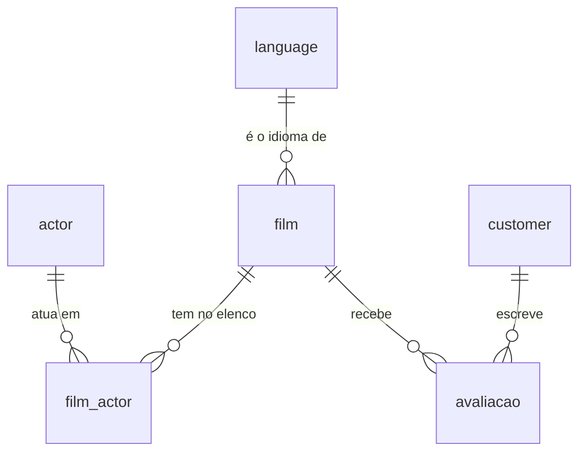
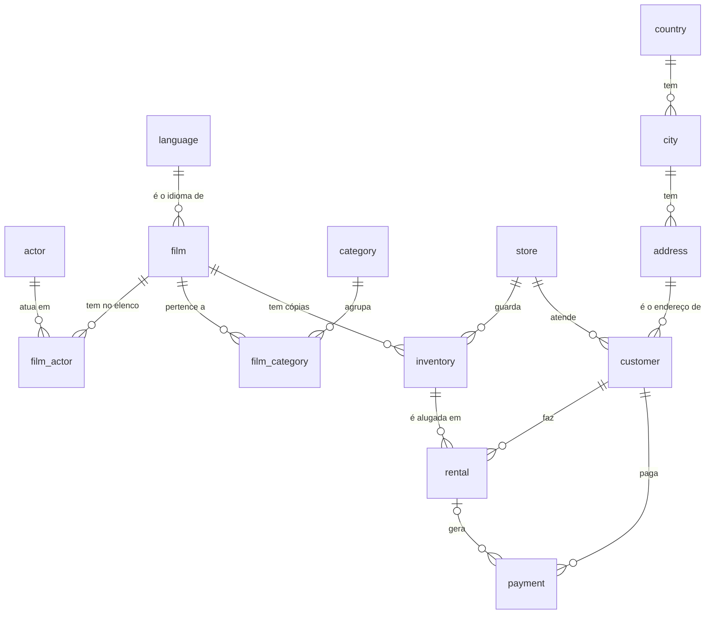
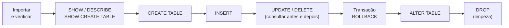

# SQL — Nível 1: Carregar, investigar e estender um banco

| Etapa | Arquivo | Tema |
|-------|---------|------|
| 0 | [my_sql_basics.md](my_sql_basics.md) | Fundamentos: banco, SGBD, cliente/servidor, ambiente com Docker e primeira conexão |
| **1** | **[sql_comandos_1.md](sql_comandos_1.md)** | **Carregar o Sakila; investigar estruturas; criar, alterar e remover tabelas; inserir e editar dados ← você está aqui** |
| 2 | [sql_comandos_2.md](sql_comandos_2.md) | Consultas em uma tabela: `SELECT`, `DISTINCT`, `WHERE`, `LIKE`, `ORDER BY`, `LIMIT` |
| 3 | [sql_comandos_3.md](sql_comandos_3.md) | Agregações: `COUNT`, `SUM`, `AVG`, `MIN`, `MAX`, `GROUP BY`, `HAVING` |
| 4 | [sql_comandos_4.md](sql_comandos_4.md) | Combinar tabelas: `INNER`, `LEFT`, `RIGHT` e `CROSS JOIN`, multiplicidade, `FULL` simulado |

> **Contrato deste arquivo**
>
> * **Objetivo:** carregar o banco de estudo e aprender a inspecionar e estender sua estrutura com segurança.
> * **Conhecimentos prévios:** [Fundamentos](my_sql_basics.md): conectar-se ao servidor pelo terminal ou Workbench.
> * **Estado inicial:** servidor `mysql:8.0.45` acessível; o banco `sakila` pode ainda não existir.
> * **Ao final, você conseguirá:** (1) importar o Sakila e verificar a importação; (2) ler a estrutura de uma tabela com `DESCRIBE` e `SHOW CREATE TABLE`; (3) escolher tipos e restrições para uma tabela nova; (4) inserir, alterar e remover linhas conferindo antes e depois; (5) usar uma transação para desfazer alterações; (6) distinguir `DELETE`, `TRUNCATE` e `DROP`.
> * **Estado final:** `sakila` igual ao importado; as tabelas auxiliares criadas aqui são removidas na seção 12.
> * **Próximo passo:** [nível 2](sql_comandos_2.md).

> Os rótulos **▶ Executar**, **✖ Erro intencional** e **◇ Ilustrativo** seguem a convenção explicada nos [Fundamentos](my_sql_basics.md). Ambiente de referência: `mysql:8.0.45`. Exceto quando indicado, os comandos SQL rodam **no cliente MySQL** (`mysql>` ou Workbench).

---

## 1. Problema

O servidor está rodando, mas contém apenas os bancos de **sistema** (`mysql`, `sys`...). Ainda falta o banco de estudo. Antes de fazer perguntas aos dados ("qual filme foi mais alugado?"), vamos:

1. **Carregar** um banco pronto e realista, o Sakila.
2. **Investigar** como suas tabelas foram construídas.
3. **Estender** o banco com uma tabela nossa, praticando criar, inserir, alterar e remover.

Analogia: você recebeu uma casa mobiliada. Primeiro aprende a ler a **planta** (estrutura), depois constrói um **cômodo novo** (uma tabela sua) e o mobília (dados). Em SQL, essas atividades têm nomes:

| Categoria | Atua sobre | Comandos deste nível |
|-----------|------------|----------------------|
| DDL (Data Definition Language) | A estrutura | `CREATE`, `ALTER`, `DROP`, `TRUNCATE`, `RENAME` |
| DML (Data Manipulation Language) | Os dados | `INSERT`, `UPDATE`, `DELETE` |

---

## 2. Bancos de dados

**▶ Executar**

```sql
SHOW DATABASES;
```

Você verá pelo menos `information_schema`, `mysql`, `performance_schema` e `sys` (bancos de sistema; não mexa neles). Se o servidor já era usado, outros bancos também aparecem.

Para praticar, crie, selecione e remova um banco descartável:

**▶ Executar**

```sql
CREATE DATABASE teste;
USE teste;
SELECT DATABASE();
```

```text
+------------+
| DATABASE() |
+------------+
| teste      |
+------------+
```

* `CREATE DATABASE` cria o banco. `CREATE DATABASE IF NOT EXISTS teste;` evita erro se ele já existir.
* `USE` define o banco "atual": os próximos comandos atuam sobre ele.
* `SELECT DATABASE()` mostra qual banco está selecionado.

**▶ Executar**

```sql
DROP DATABASE teste;
```

> `DROP DATABASE` apaga o banco **inteiro**, com todas as tabelas e dados, sem pedir confirmação. Não existe "desfazer".

---

## 3. Carregando o banco Sakila

Esta é a seção **oficial** de importação do curso. Os demais arquivos supõem que ela foi concluída.

### 3.1 O que é o Sakila

O Sakila é um banco de exemplo distribuído pela Oracle que simula uma **locadora de DVDs** com duas lojas. Quatro conceitos do domínio são **diferentes** e vale separá-los desde já:

| Conceito | Tabela | Exemplo |
|----------|--------|---------|
| **Filme** (o título no catálogo) | `film` | "ACADEMY DINOSAUR", 86 minutos |
| **Cópia física** (um DVD na prateleira de uma loja) | `inventory` | A cópia nº 1 de ACADEMY DINOSAUR, na loja 1 |
| **Aluguel** (uma cópia emprestada a um cliente) | `rental` | O cliente 130 levou uma cópia em 2005-05-24 |
| **Pagamento** (o valor pago) | `payment` | 2.99 unidades monetárias pelo aluguel |

O banco não documenta a moeda; por isso falaremos em **unidades monetárias**.

### 3.2 Os dois arquivos

A pasta [data/](data/) contém o Sakila dividido em dois arquivos, que precisam ser executados **nesta ordem**:

| Ordem | Arquivo | Conteúdo |
|-------|---------|----------|
| 1º | [sakila-schema.sql](data/sakila-schema.sql) | **Estrutura**: cria o banco `sakila`, tabelas, views, triggers e procedures |
| 2º | [sakile.sql](data/sakile.sql) | **Dados**: os `INSERT` com filmes, clientes, aluguéis... (o nome do arquivo é esse mesmo) |

Não dá para inserir dados em tabelas que ainda não existem; por isso a ordem importa.

> **⚠ Atenção:** o `sakila-schema.sql` começa com `DROP SCHEMA IF EXISTS sakila`. Se você já tem um banco `sakila` no servidor, ele será **apagado e recriado**, incluindo qualquer tabela que você tenha acrescentado a ele. Outros bancos do servidor não são afetados.

### 3.3 Importação

**Pelo terminal do host** (bash), a partir da pasta `sgbd/`, onde está a pasta `data/`:

**▶ Executar** — no terminal do host

```console
docker exec -i sgbd-mysql mysql --default-character-set=utf8mb4 -uroot -psenha_local < data/sakila-schema.sql
docker exec -i sgbd-mysql mysql --default-character-set=utf8mb4 -uroot -psenha_local < data/sakile.sql
```

O segundo arquivo tem cerca de 3 MB e leva alguns segundos. O `--default-character-set=utf8mb4` garante que nomes com acento (como a cidade `Águas Lindas de Goiás`) sejam gravados corretamente ([Fundamentos](my_sql_basics.md), seção 3.7.3).

**Pelo Workbench:** *File → Run SQL Script...*, selecione `sakila-schema.sql` e clique em *Run*. Depois repita com `sakile.sql`. Atualize o painel *Schemas* (🔄).

### 3.4 Verificando a importação

**▶ Executar**

```sql
USE sakila;
SELECT COUNT(*) FROM film;
SELECT COUNT(*) FROM rental;
```

```text
+----------+
| COUNT(*) |
+----------+
|     1000 |
+----------+

+----------+
| COUNT(*) |
+----------+
|    16044 |
+----------+
```

`COUNT(*)` conta as linhas de uma tabela (detalhes no [nível 3](sql_comandos_3.md)). Se os números forem 1000 e 16044, a importação deu certo.

### 3.5 O que você vai reconhecer nos arquivos

Abra o `sakila-schema.sql` em um editor de texto. Ao final deste nível, você vai reconhecer os principais `CREATE TABLE`, os tipos, as restrições e os `INSERT`. Por exemplo:

**◇ Ilustrativo** — trecho de `sakila-schema.sql`

```sql
CREATE TABLE actor (
  actor_id SMALLINT UNSIGNED NOT NULL AUTO_INCREMENT,
  first_name VARCHAR(45) NOT NULL,
  last_name VARCHAR(45) NOT NULL,
  last_update TIMESTAMP NOT NULL DEFAULT CURRENT_TIMESTAMP ON UPDATE CURRENT_TIMESTAMP,
  PRIMARY KEY  (actor_id),
  KEY idx_actor_last_name (last_name)
) ENGINE=InnoDB DEFAULT CHARSET=utf8mb4;
```

**◇ Ilustrativo** — início dos `INSERT` em `sakile.sql` (o arquivo continua com centenas de linhas)

```sql
INSERT INTO actor VALUES (1,'PENELOPE','GUINESS','2006-02-15 04:34:33'),
(2,'NICK','WAHLBERG','2006-02-15 04:34:33'),
(3,'ED','CHASE','2006-02-15 04:34:33'),
```

O arquivo de estrutura também contém **views**, **triggers** e **procedures**. Esses recursos ficam para depois do curso; por ora, basta saber que existem.

### 3.6 Mapa das tabelas usadas neste nível



A notação `||--o{` se lê "um para zero ou mais": um idioma pode ser o idioma de zero ou mais filmes. A tabela `avaliacao` ainda não existe; vamos criá-la na seção 7.

<details>
<summary><strong>Mapa completo das principais tabelas (referência opcional)</strong></summary>



Uma distinção importante: **regra do schema** × **característica dos dados carregados**. No schema, `payment.rental_id` aceita `NULL` (um pagamento *poderia* existir sem aluguel; por isso o `|o` no diagrama). Nos dados deste curso, porém, todos os 16044 pagamentos estão ligados a um aluguel. A regra diz o que é **permitido**; os dados mostram o que **aconteceu**.

</details>

---

## 4. Investigando a estrutura

### 4.1 `SHOW TABLES`: o que existe?

**▶ Executar**

```sql
SHOW FULL TABLES;
```

Saída resumida:

```text
+----------------------------+------------+
| Tables_in_sakila           | Table_type |
+----------------------------+------------+
| actor                      | BASE TABLE |
| actor_info                 | VIEW       |
| address                    | BASE TABLE |
| ...                        | ...        |
| sales_by_film_category     | VIEW       |
| ...                        | ...        |
+----------------------------+------------+
23 rows in set
```

O Sakila tem 16 tabelas (`BASE TABLE`) e 7 **views** (consultas salvas que se comportam como tabelas). `SHOW TABLES;` lista as mesmas 23, sem a coluna de tipo.

### 4.2 `DESCRIBE`: como é a tabela?

**▶ Executar**

```sql
DESCRIBE customer;
```

```text
+-------------+-------------------+------+-----+-------------------+-----------------------------------------------+
| Field       | Type              | Null | Key | Default           | Extra                                         |
+-------------+-------------------+------+-----+-------------------+-----------------------------------------------+
| customer_id | smallint unsigned | NO   | PRI | NULL              | auto_increment                                |
| store_id    | tinyint unsigned  | NO   | MUL | NULL              |                                               |
| first_name  | varchar(45)       | NO   |     | NULL              |                                               |
| last_name   | varchar(45)       | NO   | MUL | NULL              |                                               |
| email       | varchar(50)       | YES  |     | NULL              |                                               |
| address_id  | smallint unsigned | NO   | MUL | NULL              |                                               |
| active      | tinyint(1)        | NO   |     | 1                 |                                               |
| create_date | datetime          | NO   |     | NULL              |                                               |
| last_update | timestamp         | YES  |     | CURRENT_TIMESTAMP | DEFAULT_GENERATED on update CURRENT_TIMESTAMP |
+-------------+-------------------+------+-----+-------------------+-----------------------------------------------+
```

| Coluna | Significado |
|--------|-------------|
| `Field` | Nome da coluna |
| `Type` | Tipo de dado |
| `Null` | `YES`: aceita `NULL`; `NO`: obrigatória |
| `Key` | Informação sobre **índices**: `PRI` = faz parte da chave primária; `UNI` = índice único; `MUL` = primeira coluna de um índice que permite repetição |
| `Default` | Valor padrão. `NULL` aqui pode significar "o padrão é `NULL`" **ou** "não há padrão"; compare com a coluna `Null` |
| `Extra` | Informações adicionais, como `auto_increment` |

> **Cuidado:** `MUL` **não prova** que a coluna é chave estrangeira. Em `customer`, `last_name` tem `MUL` apenas porque existe um índice para buscas por sobrenome; `store_id` e `address_id` têm `MUL` porque as chaves estrangeiras criam índices. Para confirmar uma chave estrangeira, use `SHOW CREATE TABLE`.

`DESC customer;` e `SHOW COLUMNS FROM customer;` produzem o mesmo resultado.

### 4.3 `SHOW CREATE TABLE`: a definição completa

**▶ Executar** (no terminal, o `\G` mostra o resultado na vertical; no Workbench, use `;`)

```sql
SHOW CREATE TABLE film_actor\G
```

```text
*************************** 1. row ***************************
       Table: film_actor
Create Table: CREATE TABLE `film_actor` (
  `actor_id` smallint unsigned NOT NULL,
  `film_id` smallint unsigned NOT NULL,
  `last_update` timestamp NOT NULL DEFAULT CURRENT_TIMESTAMP ON UPDATE CURRENT_TIMESTAMP,
  PRIMARY KEY (`actor_id`,`film_id`),
  KEY `idx_fk_film_id` (`film_id`),
  CONSTRAINT `fk_film_actor_actor` FOREIGN KEY (`actor_id`) REFERENCES `actor` (`actor_id`) ON DELETE RESTRICT ON UPDATE CASCADE,
  CONSTRAINT `fk_film_actor_film` FOREIGN KEY (`film_id`) REFERENCES `film` (`film_id`) ON DELETE RESTRICT ON UPDATE CASCADE
) ENGINE=InnoDB DEFAULT CHARSET=utf8mb4 COLLATE=utf8mb4_0900_ai_ci
```

O que essa definição revela:

* **`CONSTRAINT ... FOREIGN KEY`**: aqui, sim, estão as chaves estrangeiras confirmadas: `actor_id` aponta para `actor` e `film_id` aponta para `film`.
* **`PRIMARY KEY (actor_id, film_id)`**: uma **chave primária composta**. Um ator aparece em vários filmes e um filme tem vários atores, mas o **par** (ator, filme) nunca se repete. `film_actor` é uma **tabela de ligação**.
* **`ON DELETE RESTRICT`**: impede apagar um ator que ainda está no elenco de algum filme.
* **`ON UPDATE CASCADE`**: se um `actor_id` mudar em `actor`, a mudança é propagada para `film_actor`.
* **`COLLATE=utf8mb4_0900_ai_ci`**: a regra de comparação de textos. `ai` = ignora acentos; `ci` = ignora maiúsculas e minúsculas. Isso vai importar no nível 2.

### 4.4 Espiando os dados de uma tabela pequena

**▶ Executar**

```sql
SELECT * FROM language ORDER BY language_id;
```

```text
+-------------+----------+---------------------+
| language_id | name     | last_update         |
+-------------+----------+---------------------+
|           1 | English  | 2006-02-15 05:02:19 |
|           2 | Italian  | 2006-02-15 05:02:19 |
|           3 | Japanese | 2006-02-15 05:02:19 |
|           4 | Mandarin | 2006-02-15 05:02:19 |
|           5 | French   | 2006-02-15 05:02:19 |
|           6 | German   | 2006-02-15 05:02:19 |
+-------------+----------+---------------------+
```

`*` significa "todas as colunas"; `ORDER BY language_id` ordena pelo identificador (explicado no nível 2). Evite `SELECT *` em tabelas grandes: em `rental`, seriam 16044 linhas.

> **✅ Verifique**
>
> 1. Em `DESCRIBE customer`, a coluna `email` é obrigatória?
> 2. Como você confirmaria que `customer.address_id` é uma chave estrangeira?
>
> *Respostas:* (1) Não: `Null` = `YES`. (2) Com `SHOW CREATE TABLE customer;`, procurando um `CONSTRAINT ... FOREIGN KEY (address_id)`.

---

## 5. Tipos de dados

Cada coluna tem um **tipo**, que define que valores ela aceita.

| Tipo | Guarda | Exemplo no Sakila |
|------|--------|-------------------|
| `TINYINT` / `SMALLINT` / `MEDIUMINT` / `INT` | Inteiros de capacidade crescente | `film.length SMALLINT` |
| `UNSIGNED` | Modificador: só zero e positivos, dobrando o limite superior | `actor_id SMALLINT UNSIGNED` (0 a 65535) |
| `DECIMAL(p,s)` | Decimal **exato**: `p` dígitos no total, `s` depois do ponto | `payment.amount DECIMAL(5,2)` |
| `CHAR(n)` / `VARCHAR(n)` | Texto de tamanho fixo / variável até `n` caracteres | `actor.first_name VARCHAR(45)` |
| `TEXT` | Texto longo | `film.description` |
| `DATE` | Data | (usaremos em `avaliacao`) |
| `DATETIME` | Data e hora | `rental.rental_date` |
| `TIMESTAMP` | Data e hora com regras próprias de fuso horário e faixa de valores; pode receber atualização automática se declarada | `last_update ... DEFAULT CURRENT_TIMESTAMP ON UPDATE CURRENT_TIMESTAMP` |
| `BOOLEAN` | Sinônimo de `TINYINT(1)`. Por convenção guarda `1` (verdadeiro) e `0` (falso), mas **não impede** outros números | `customer.active` |
| `ENUM(...)` | Um valor de uma lista fixa | `film.rating ENUM('G','PG','PG-13','R','NC-17')` |

Repare: a atualização automática de `last_update` vem das cláusulas `DEFAULT ... ON UPDATE ...` escritas na coluna, e não do tipo `TIMESTAMP` em si.

**Por que `DECIMAL` para dinheiro?** Tipos de ponto flutuante (`FLOAT`, `DOUBLE`) guardam aproximações. Compare:

**▶ Executar**

```sql
SELECT 0.1 + 0.2 AS exato, 1e-1 + 2e-1 AS aproximado;
```

```text
+-------+---------------------+
| exato | aproximado          |
+-------+---------------------+
|   0.3 | 0.30000000000000004 |
+-------+---------------------+
```

`0.1` é um literal decimal exato; `1e-1` (notação científica) é um número de ponto flutuante. Em valores monetários, a diferença acumulada vira erro de centavos.

---

## 6. Restrições, atributos e valores padrão

São três coisas diferentes que aparecem na definição de uma coluna:

| Categoria | Item | O que garante | Cuidado |
|-----------|------|---------------|---------|
| **Restrição** | `PRIMARY KEY` | Identifica cada linha: valor único e nunca nulo | |
| **Restrição** | `FOREIGN KEY ... REFERENCES` | O valor precisa existir na tabela referenciada | |
| **Restrição** | `UNIQUE` | Não há dois valores iguais | No MySQL, permite **vários** `NULL` |
| **Restrição** | `NOT NULL` | A coluna sempre tem valor | **Não** impede texto vazio `''` |
| **Restrição** | `CHECK (condição)` | O valor satisfaz a condição | Aplicada pelo MySQL a partir do 8.0.16 (nossa versão é 8.0.45). Não substitui `NOT NULL`: um `NULL` não viola um `CHECK` |
| **Atributo** | `AUTO_INCREMENT` | O MySQL gera números crescentes para a chave | **Não** promete sequência sem lacunas |
| **Valor padrão** | `DEFAULT valor` | Valor usado quando o `INSERT` não informa a coluna | Não é uma restrição: qualquer outro valor válido continua aceito |

Dois desses cuidados, demonstrados em uma tabela temporária (`TEMPORARY` faz a tabela existir só nesta sessão; ela some sozinha ao desconectar):

**▶ Executar**

```sql
CREATE TEMPORARY TABLE teste_restricoes (
    nome  VARCHAR(10) NOT NULL,
    email VARCHAR(20) UNIQUE
);
INSERT INTO teste_restricoes VALUES ('', NULL), ('Bia', NULL);
SELECT * FROM teste_restricoes;
```

```text
+------+-------+
| nome | email |
+------+-------+
|      | NULL  |
| Bia  | NULL  |
+------+-------+
```

O texto vazio passou pelo `NOT NULL`, e os dois `NULL` passaram pelo `UNIQUE`.

---

## 7. Criar tabelas

### 7.1 A regra de negócio

O Sakila não guarda a **opinião** dos clientes sobre os filmes. Vamos criar a tabela `avaliacao` com estas regras:

| Regra | Decisão de modelagem |
|-------|----------------------|
| Cada avaliação tem um identificador | `avaliacao_id INT AUTO_INCREMENT PRIMARY KEY` |
| Uma avaliação é de um filme que existe | `film_id` com o **mesmo tipo** de `film.film_id` + `FOREIGN KEY` |
| ... feita por um cliente que existe | `customer_id` com o mesmo tipo de `customer.customer_id` + `FOREIGN KEY` |
| A nota vai de 1 a 5 e é obrigatória | `TINYINT NOT NULL` + `CHECK (nota BETWEEN 1 AND 5)` |
| O comentário é opcional | `VARCHAR(200)` sem `NOT NULL` |
| A data é obrigatória | `DATE NOT NULL` |
| **Cada cliente avalia cada filme no máximo uma vez** (para mudar de opinião, ele edita a avaliação) | `UNIQUE (customer_id, film_id)` |

Para descobrir o tipo exato das colunas referenciadas, consulte `DESCRIBE film;` e `DESCRIBE customer;`: ambas são `smallint unsigned`.

### 7.2 O comando

**▶ Executar**

```sql
CREATE TABLE avaliacao (
    avaliacao_id   INT AUTO_INCREMENT PRIMARY KEY,
    film_id        SMALLINT UNSIGNED NOT NULL,
    customer_id    SMALLINT UNSIGNED NOT NULL,
    nota           TINYINT NOT NULL,
    comentario     VARCHAR(200),
    data_avaliacao DATE NOT NULL,
    CONSTRAINT fk_avaliacao_film          FOREIGN KEY (film_id)     REFERENCES film (film_id),
    CONSTRAINT fk_avaliacao_customer      FOREIGN KEY (customer_id) REFERENCES customer (customer_id),
    CONSTRAINT ck_avaliacao_nota          CHECK (nota BETWEEN 1 AND 5),
    CONSTRAINT uq_avaliacao_cliente_filme UNIQUE (customer_id, film_id)
);
```

`CONSTRAINT nome ...` dá um **nome** a cada restrição. Sem ele, o MySQL inventa nomes como `avaliacao_ibfk_1`; com ele, as mensagens de erro ficam autoexplicativas.

**▶ Executar**

```sql
SHOW CREATE TABLE avaliacao\G
```

```text
Create Table: CREATE TABLE `avaliacao` (
  `avaliacao_id` int NOT NULL AUTO_INCREMENT,
  `film_id` smallint unsigned NOT NULL,
  `customer_id` smallint unsigned NOT NULL,
  `nota` tinyint NOT NULL,
  `comentario` varchar(200) DEFAULT NULL,
  `data_avaliacao` date NOT NULL,
  PRIMARY KEY (`avaliacao_id`),
  UNIQUE KEY `uq_avaliacao_cliente_filme` (`customer_id`,`film_id`),
  KEY `fk_avaliacao_film` (`film_id`),
  CONSTRAINT `fk_avaliacao_customer` FOREIGN KEY (`customer_id`) REFERENCES `customer` (`customer_id`),
  CONSTRAINT `fk_avaliacao_film` FOREIGN KEY (`film_id`) REFERENCES `film` (`film_id`),
  CONSTRAINT `ck_avaliacao_nota` CHECK ((`nota` between 1 and 5))
) ENGINE=InnoDB DEFAULT CHARSET=utf8mb4 COLLATE=utf8mb4_0900_ai_ci
```

As duas chaves estrangeiras, o `CHECK` e o `UNIQUE` estão confirmados.

### 7.3 Erro intencional: tipos incompatíveis na chave estrangeira

Para chaves inteiras, a coluna que referencia precisa ter o **mesmo tipo inteiro e o mesmo sinal** (`UNSIGNED` ou não) da coluna referenciada. Veja o que acontece se usarmos `INT` contra o `SMALLINT UNSIGNED` de `film`:

**✖ Erro intencional** (nome diferente de propósito, para não conflitar com `avaliacao`)

```sql
CREATE TABLE avaliacao_tipo_incompativel (
    id      INT PRIMARY KEY,
    film_id INT NOT NULL,
    FOREIGN KEY (film_id) REFERENCES film (film_id)
);
```

```text
ERROR 3780 (HY000): Referencing column 'film_id' and referenced column 'film_id' in foreign key constraint 'avaliacao_tipo_incompativel_ibfk_1' are incompatible.
```

A tabela **não** foi criada. Confira:

**▶ Executar**

```sql
SHOW TABLES LIKE 'avaliacao%';
```

```text
+-------------------------------+
| Tables_in_sakila (avaliacao%) |
+-------------------------------+
| avaliacao                     |
+-------------------------------+
```

> **Estado:** `avaliacao` existe e está vazia.

---

## 8. Inserir dados

### 8.1 `INSERT INTO`

**▶ Executar**

```sql
INSERT INTO avaliacao (film_id, customer_id, nota, comentario, data_avaliacao) VALUES
    (1, 1, 5, 'Excelente!', '2006-02-15'),
    (1, 2, 4, 'Muito bom',  '2006-02-15'),
    (2, 1, 2, NULL,         '2006-02-16'),
    (3, 3, 3, 'Razoável',   '2006-02-16'),
    (2, 4, 1, 'Não gostei', '2006-02-17');
```

* Não informamos `avaliacao_id`: o `AUTO_INCREMENT` o gera.
* A **lista de colunas** depois do nome da tabela é uma boa prática: sem ela, os valores precisam seguir exatamente a ordem das colunas, e o comando quebra se a tabela mudar.
* `NULL` (sem aspas) significa **ausência de valor**: o cliente 1 não escreveu comentário sobre o filme 2. É diferente de `'NULL'` (o texto) e de `''` (texto vazio). O nível 2 aprofunda.
* Referências: filmes 1, 2, 3 = ACADEMY DINOSAUR, ACE GOLDFINGER, ADAPTATION HOLES; clientes 1 a 4 = MARY SMITH, PATRICIA JOHNSON, LINDA WILLIAMS, BARBARA JONES.

**▶ Executar**

```sql
SELECT * FROM avaliacao ORDER BY avaliacao_id;
```

```text
+--------------+---------+-------------+------+------------+----------------+
| avaliacao_id | film_id | customer_id | nota | comentario | data_avaliacao |
+--------------+---------+-------------+------+------------+----------------+
|            1 |       1 |           1 |    5 | Excelente! | 2006-02-15     |
|            2 |       1 |           2 |    4 | Muito bom  | 2006-02-15     |
|            3 |       2 |           1 |    2 | NULL       | 2006-02-16     |
|            4 |       3 |           3 |    3 | Razoável   | 2006-02-16     |
|            5 |       2 |           4 |    1 | Não gostei | 2006-02-17     |
+--------------+---------+-------------+------+------------+----------------+
```

> **Estado:** 5 avaliações, IDs 1 a 5.

### 8.2 As restrições em ação

Cada comando abaixo viola uma regra. **Nenhum deles altera os dados**: a tabela continua com as 5 avaliações. (Alguns consomem números do `AUTO_INCREMENT`, como a seção 8.3 mostra.) Execute-os um por vez para ver cada mensagem.

**✖ Erro intencional** — chave estrangeira: não existe filme 5000

```sql
INSERT INTO avaliacao (film_id, customer_id, nota, data_avaliacao) VALUES (5000, 1, 5, '2006-02-18');
```

```text
ERROR 1452 (23000): Cannot add or update a child row: a foreign key constraint fails
(`sakila`.`avaliacao`, CONSTRAINT `fk_avaliacao_film` FOREIGN KEY (`film_id`) REFERENCES `film` (`film_id`))
```

**✖ Erro intencional** — `CHECK`: nota fora de 1 a 5

```sql
INSERT INTO avaliacao (film_id, customer_id, nota, data_avaliacao) VALUES (1, 5, 6, '2006-02-18');
```

```text
ERROR 3819 (HY000): Check constraint 'ck_avaliacao_nota' is violated.
```

**✖ Erro intencional** — `UNIQUE`: o cliente 1 já avaliou o filme 1

```sql
INSERT INTO avaliacao (film_id, customer_id, nota, data_avaliacao) VALUES (1, 1, 4, '2006-02-18');
```

```text
ERROR 1062 (23000): Duplicate entry '1-1' for key 'avaliacao.uq_avaliacao_cliente_filme'
```

**✖ Erro intencional** — `NOT NULL`: `nota` é obrigatória e não tem valor padrão

```sql
INSERT INTO avaliacao (film_id, customer_id, data_avaliacao) VALUES (1, 5, '2006-02-18');
```

```text
ERROR 1364 (HY000): Field 'nota' doesn't have a default value
```

| Erro | Regra violada | Estado da tabela depois |
|------|---------------|-------------------------|
| 1452 | `fk_avaliacao_film` | Inalterado (5 linhas) |
| 3819 | `ck_avaliacao_nota` | Inalterado |
| 1062 | `uq_avaliacao_cliente_filme` | Inalterado |
| 1364 | `NOT NULL` sem `DEFAULT` em `nota` | Inalterado |

### 8.3 `AUTO_INCREMENT` não promete sequência sem lacunas

Agora uma inserção válida:

**▶ Executar**

```sql
INSERT INTO avaliacao (film_id, customer_id, nota, comentario, data_avaliacao)
VALUES (4, 5, 4, 'Boa trilha sonora', '2006-02-18');

SELECT * FROM avaliacao ORDER BY avaliacao_id;
```

```text
+--------------+---------+-------------+------+-------------------+----------------+
| avaliacao_id | film_id | customer_id | nota | comentario        | data_avaliacao |
+--------------+---------+-------------+------+-------------------+----------------+
|            1 |       1 |           1 |    5 | Excelente!        | 2006-02-15     |
|            2 |       1 |           2 |    4 | Muito bom         | 2006-02-15     |
|            3 |       2 |           1 |    2 | NULL              | 2006-02-16     |
|            4 |       3 |           3 |    3 | Razoável          | 2006-02-16     |
|            5 |       2 |           4 |    1 | Não gostei        | 2006-02-17     |
|            8 |       4 |           5 |    4 | Boa trilha sonora | 2006-02-18     |
+--------------+---------+-------------+------+-------------------+----------------+
```

O novo ID foi **8**, não 6. No ambiente de referência, com os quatro erros da seção 8.2 executados, duas das tentativas que falharam já tinham reservado os números 6 e 7. Se você pulou os erros intencionais, verá **6**. A lição é que o `AUTO_INCREMENT` garante números **únicos e crescentes**, não **consecutivos**. Nunca use o ID para contar linhas.

> **Estado:** 6 avaliações (IDs 1 a 5 e mais uma, com ID 8 ou 6 conforme o parágrafo acima). As saídas seguintes mostram 8.

---

## 9. Editar e remover dados

### 9.1 O mínimo de `WHERE` para começar

`UPDATE` e `DELETE` precisam saber **quais** linhas afetar. Isso é dito com `WHERE`, seguido de uma condição. Por enquanto, usaremos apenas igualdade com a chave primária, que identifica exatamente uma linha:

**◇ Ilustrativo**

```sql
SELECT * FROM tabela WHERE chave = valor;
```

O `WHERE` completo (outros operadores, `AND`, `OR`...) é o assunto do nível 2. O hábito que vale desde já:

> **Consultar com o filtro → alterar com o mesmo filtro → consultar de novo.**

### 9.2 `UPDATE`: alterar valores

O cliente 1 reviu o filme 2 e mudou de opinião. Pela regra da seção 7.1, ele **edita** a avaliação existente.

**▶ Executar** — 1. consultar

```sql
SELECT * FROM avaliacao WHERE avaliacao_id = 3;
```

```text
+--------------+---------+-------------+------+------------+----------------+
| avaliacao_id | film_id | customer_id | nota | comentario | data_avaliacao |
+--------------+---------+-------------+------+------------+----------------+
|            3 |       2 |           1 |    2 | NULL       | 2006-02-16     |
+--------------+---------+-------------+------+------------+----------------+
```

**▶ Executar** — 2. alterar e 3. consultar de novo

```sql
UPDATE avaliacao
SET nota = 3, comentario = 'Melhorou na segunda vez'
WHERE avaliacao_id = 3;

SELECT * FROM avaliacao WHERE avaliacao_id = 3;
```

```text
Query OK, 1 row affected
Rows matched: 1  Changed: 1  Warnings: 0

+--------------+---------+-------------+------+-------------------------+----------------+
| avaliacao_id | film_id | customer_id | nota | comentario              | data_avaliacao |
+--------------+---------+-------------+------+-------------------------+----------------+
|            3 |       2 |           1 |    3 | Melhorou na segunda vez | 2006-02-16     |
+--------------+---------+-------------+------+-------------------------+----------------+
```

| Trecho | Significado |
|--------|-------------|
| `UPDATE avaliacao` | Tabela a ser alterada |
| `SET nota = 3, comentario = '...'` | Novos valores (uma ou mais colunas, separadas por vírgula) |
| `WHERE avaliacao_id = 3` | **Quais** linhas alterar |

### 9.3 `DELETE`: remover linhas

A avaliação 5 era spam.

**▶ Executar**

```sql
SELECT * FROM avaliacao WHERE avaliacao_id = 5;
DELETE FROM avaliacao WHERE avaliacao_id = 5;
SELECT * FROM avaliacao ORDER BY avaliacao_id;
```

```text
+--------------+---------+-------------+------+-------------------------+----------------+
| avaliacao_id | film_id | customer_id | nota | comentario              | data_avaliacao |
+--------------+---------+-------------+------+-------------------------+----------------+
|            1 |       1 |           1 |    5 | Excelente!              | 2006-02-15     |
|            2 |       1 |           2 |    4 | Muito bom               | 2006-02-15     |
|            3 |       2 |           1 |    3 | Melhorou na segunda vez | 2006-02-16     |
|            4 |       3 |           3 |    3 | Razoável                | 2006-02-16     |
|            8 |       4 |           5 |    4 | Boa trilha sonora       | 2006-02-18     |
+--------------+---------+-------------+------+-------------------------+----------------+
```

(A primeira consulta mostrou a linha 5; a última mostra o resultado final.)

> **Estado:** 5 avaliações (IDs 1, 2, 3, 4 e 8).

---

## 10. Transações na prática

### 10.1 Desfazendo um erro com `ROLLBACK`

Sem `WHERE`, `UPDATE` e `DELETE` valem para **todas** as linhas. Vamos ver isso acontecer **dentro de uma transação**, que nos permite desfazer tudo:

**▶ Executar** — os quatro comandos em sequência, na mesma sessão

```sql
START TRANSACTION;
DELETE FROM avaliacao;
SELECT COUNT(*) AS avaliacoes FROM avaliacao;
ROLLBACK;
```

```text
Query OK, 5 rows affected

+------------+
| avaliacoes |
+------------+
|          0 |
+------------+
```

A tabela ficou vazia, mas a transação não foi confirmada. O `ROLLBACK` desfaz tudo:

**▶ Executar**

```sql
SELECT COUNT(*) AS avaliacoes FROM avaliacao;
```

```text
+------------+
| avaliacoes |
+------------+
|          5 |
+------------+
```

**Safe updates.** Alguns clientes ativam uma proteção de sessão chamada *safe update mode*, que recusa `UPDATE` e `DELETE` sem um `WHERE` sobre uma coluna-chave. O Workbench costuma vir com ela ligada; o cliente `mysql` do terminal não, mas pode ser iniciado com `mysql --safe-updates`. Com a proteção ativa, o `DELETE` acima é recusado:

```text
ERROR 1175 (HY000): You are using safe update mode and you tried to update a table without a WHERE that uses a KEY column.
```

Nos dois casos, a tabela termina com as 5 avaliações. Mantenha a proteção ligada: ela existe para evitar exatamente esse acidente.

### 10.2 Nem tudo pode ser desfeito: commit implícito

Comandos de estrutura (DDL), como `TRUNCATE`, `DROP` e `ALTER`, **confirmam automaticamente** a transação em andamento. O `ROLLBACK` não os desfaz. Para ver isso sem arriscar a tabela principal, usamos uma cópia descartável:

**▶ Executar**

```sql
CREATE TABLE avaliacao_copia AS SELECT * FROM avaliacao;

START TRANSACTION;
TRUNCATE TABLE avaliacao_copia;
ROLLBACK;

SELECT COUNT(*) AS linhas_na_copia FROM avaliacao_copia;
```

```text
+-----------------+
| linhas_na_copia |
+-----------------+
|               0 |
+-----------------+
```

A cópia continua vazia: o `TRUNCATE` foi confirmado na hora. Limpe a cópia:

**▶ Executar**

```sql
DROP TABLE avaliacao_copia;
```

> **Estado:** `avaliacao` com 5 linhas; `avaliacao_copia` removida.

---

## 11. Editar tabelas: `ALTER TABLE`

| Operação | Comando |
|----------|---------|
| Adicionar coluna | `ALTER TABLE t ADD COLUMN col TIPO ...;` |
| Redefinir uma coluna | `ALTER TABLE t MODIFY COLUMN col DEFINIÇÃO_COMPLETA;` |
| Renomear coluna | `ALTER TABLE t RENAME COLUMN antigo TO novo;` |
| Remover coluna | `ALTER TABLE t DROP COLUMN col;` |
| Renomear tabela | `RENAME TABLE antigo TO novo;` |

### 11.1 Adicionar uma coluna

**Antes:** `avaliacao` tem 6 colunas. Queremos saber se o cliente recomenda o filme.

**▶ Executar**

```sql
ALTER TABLE avaliacao ADD COLUMN recomenda BOOLEAN DEFAULT TRUE;
SELECT avaliacao_id, nota, recomenda FROM avaliacao ORDER BY avaliacao_id;
```

```text
+--------------+------+-----------+
| avaliacao_id | nota | recomenda |
+--------------+------+-----------+
|            1 |    5 |         1 |
|            2 |    4 |         1 |
|            3 |    3 |         1 |
|            4 |    3 |         1 |
|            8 |    4 |         1 |
+--------------+------+-----------+
```

As linhas existentes receberam o valor padrão (`TRUE`, guardado como `1`). Neste caso, uma coluna sem `DEFAULT` e sem `NOT NULL` receberia `NULL`.

Lembra que `BOOLEAN` é só um `TINYINT(1)`?

**▶ Executar**

```sql
UPDATE avaliacao SET recomenda = 2 WHERE avaliacao_id = 1;
SELECT avaliacao_id, recomenda FROM avaliacao WHERE avaliacao_id = 1;
```

```text
+--------------+-----------+
| avaliacao_id | recomenda |
+--------------+-----------+
|            1 |         2 |
+--------------+-----------+
```

O MySQL aceitou o `2`. Para limitar a 0 e 1, seria preciso um `CHECK (recomenda IN (0, 1))`. Volte ao valor correto:

**▶ Executar**

```sql
UPDATE avaliacao SET recomenda = TRUE WHERE avaliacao_id = 1;
```

### 11.2 `MODIFY` substitui a definição inteira

`MODIFY COLUMN` não "ajusta" uma coluna: ele a **redefine**. O que você não repetir é perdido. Veja com `data_avaliacao`, hoje `DATE NOT NULL`:

**▶ Executar**

```sql
ALTER TABLE avaliacao MODIFY COLUMN data_avaliacao DATE;
DESCRIBE avaliacao;
```

```text
| data_avaliacao | date              | YES  |     | NULL    |                |
```

(Linha relevante da saída.) O `NOT NULL` sumiu, porque não foi repetido. Restaure a definição completa:

**▶ Executar**

```sql
ALTER TABLE avaliacao MODIFY COLUMN data_avaliacao DATE NOT NULL;
```

### 11.3 Aumentar e renomear uma coluna

200 caracteres ficaram pouco, e `opiniao` descreve melhor o conteúdo:

**▶ Executar**

```sql
ALTER TABLE avaliacao MODIFY COLUMN comentario VARCHAR(500);
ALTER TABLE avaliacao RENAME COLUMN comentario TO opiniao;
DESCRIBE avaliacao;
```

```text
+----------------+-------------------+------+-----+---------+----------------+
| Field          | Type              | Null | Key | Default | Extra          |
+----------------+-------------------+------+-----+---------+----------------+
| avaliacao_id   | int               | NO   | PRI | NULL    | auto_increment |
| film_id        | smallint unsigned | NO   | MUL | NULL    |                |
| customer_id    | smallint unsigned | NO   | MUL | NULL    |                |
| nota           | tinyint           | NO   |     | NULL    |                |
| opiniao        | varchar(500)      | YES  |     | NULL    |                |
| data_avaliacao | date              | NO   |     | NULL    |                |
| recomenda      | tinyint(1)        | YES  |     | 1       |                |
+----------------+-------------------+------+-----+---------+----------------+
```

(`comentario` não tinha `NOT NULL`, então `VARCHAR(500)` sozinho preserva a definição desejada.)

**Observação:** uma coluna usada em um `CHECK` não pode ser renomeada diretamente. Tentar renomear `nota` gera `ERROR 3959 (HY000): Check constraint 'ck_avaliacao_nota' uses column 'nota', hence column cannot be dropped or renamed.` Seria preciso remover a restrição (`ALTER TABLE avaliacao DROP CHECK ck_avaliacao_nota;`), renomear e recriá-la, o que não faremos aqui.

### 11.4 Remover uma coluna e renomear a tabela

**▶ Executar**

```sql
ALTER TABLE avaliacao DROP COLUMN recomenda;
RENAME TABLE avaliacao TO avaliacoes;
SHOW TABLES LIKE 'avalia%';
```

```text
+----------------------------+
| Tables_in_sakila (avalia%) |
+----------------------------+
| avaliacoes                 |
+----------------------------+
```

> **Estado:** a tabela agora se chama **`avaliacoes`**, com 5 linhas e as colunas `avaliacao_id`, `film_id`, `customer_id`, `nota`, `opiniao` e `data_avaliacao`. Os comandos anteriores usavam o nome antigo; daqui em diante, use o novo.

---

## 12. Remover tabelas

### 12.1 `DELETE` × `TRUNCATE` × `DROP`

| Comando | Remove | A tabela continua existindo? | `WHERE`? | Desfazível com `ROLLBACK`? |
|---------|--------|------------------------------|----------|----------------------------|
| `DELETE FROM t WHERE ...` | Algumas linhas | Sim | Sim | Sim, dentro de uma transação |
| `DELETE FROM t` | Todas as linhas, uma a uma | Sim | — | Sim, dentro de uma transação |
| `TRUNCATE TABLE t` | Todas as linhas, de uma vez (reinicia o `AUTO_INCREMENT`) | Sim | Não | **Não** (commit implícito) |
| `DROP TABLE t` | A tabela inteira: estrutura e dados | **Não** | Não | **Não** (commit implícito) |

Analogia com um caderno: `DELETE` apaga linhas com borracha; `TRUNCATE` arranca todas as folhas escritas, mas mantém o caderno; `DROP` joga o caderno fora.

### 12.2 Chaves estrangeiras protegem as tabelas referenciadas

**✖ Erro intencional** — não faz parte da limpeza

```sql
DROP TABLE film;
```

```text
ERROR 3730 (HY000): Cannot drop table 'film' referenced by a foreign key constraint 'fk_film_actor_film' on table 'film_actor'.
```

O MySQL impede, porque outras tabelas ficariam apontando para filmes inexistentes.

### 12.3 Limpeza

A `avaliacoes` não é referenciada por ninguém, então pode ser removida:

**▶ Executar**

```sql
DROP TABLE avaliacoes;
SHOW TABLES LIKE 'avalia%';
```

```text
Empty set
```

Para não dar erro caso a tabela não exista: `DROP TABLE IF EXISTS avaliacoes;`

> **Estado final deste nível:** o `sakila` está igual ao importado (16 tabelas, 7 views). Este é o estado esperado pelo nível 2.

**Como refazer os exemplos:** para praticar de novo, recomece na seção 7.2 (`CREATE TABLE avaliacao`). Não é preciso reimportar o Sakila. Reimportar (seção 3) só é necessário se você alterar ou apagar tabelas **originais** do Sakila, e lembre que ela apaga tudo o que você tiver acrescentado ao banco `sakila`.

---

## 13. Uma prévia do que vem por aí

Com as cinco avaliações originais da seção 8.1, seria possível responder "qual a nota média de cada filme?" e mostrar os títulos:

**◇ Ilustrativo** — supõe o estado da seção 8.1 (a tabela já foi removida)

```sql
SELECT f.title, AVG(a.nota) AS media
FROM avaliacao a
JOIN film f ON f.film_id = a.film_id
GROUP BY f.title
ORDER BY media DESC;
```

```text
+------------------+--------+
| title            | media  |
+------------------+--------+
| ACADEMY DINOSAUR | 4.5000 |
| ADAPTATION HOLES | 3.0000 |
| ACE GOLDFINGER   | 1.5000 |
+------------------+--------+
```

`AVG` e `GROUP BY` são o assunto do [nível 3](sql_comandos_3.md); `JOIN`, do [nível 4](sql_comandos_4.md).

---

## 14. Resumindo



| Comando | Categoria | Exemplo |
|---------|-----------|---------|
| `CREATE DATABASE` / `DROP DATABASE` | DDL | `CREATE DATABASE teste;` |
| `SHOW FULL TABLES` | Inspeção | `SHOW FULL TABLES;` |
| `DESCRIBE` | Inspeção | `DESCRIBE customer;` |
| `SHOW CREATE TABLE` | Inspeção | `SHOW CREATE TABLE film_actor;` |
| `CREATE TABLE` | DDL | `CREATE TABLE avaliacao (...);` |
| `ALTER TABLE` | DDL | `ALTER TABLE avaliacao ADD COLUMN recomenda BOOLEAN;` |
| `RENAME TABLE` | DDL | `RENAME TABLE avaliacao TO avaliacoes;` |
| `TRUNCATE TABLE` | DDL | `TRUNCATE TABLE avaliacao_copia;` |
| `DROP TABLE` | DDL | `DROP TABLE avaliacoes;` |
| `INSERT INTO` | DML | `INSERT INTO avaliacao (...) VALUES (...);` |
| `UPDATE` | DML | `UPDATE avaliacao SET nota = 3 WHERE avaliacao_id = 3;` |
| `DELETE` | DML | `DELETE FROM avaliacao WHERE avaliacao_id = 5;` |
| `START TRANSACTION` / `COMMIT` / `ROLLBACK` | TCL | `START TRANSACTION; ... ROLLBACK;` |

---

## 15. Exercícios

1. **Leitura de estrutura.** Execute `DESCRIBE rental;`. (a) Qual coluna aceita `NULL` e por que isso faz sentido no domínio? (b) `rental_date` aparece com `MUL`. Isso significa que ela é chave estrangeira? Como confirmar?
2. **Tipos e restrições.** Crie a tabela `lista_desejos`: um cliente marca filmes que quer alugar, com a data em que marcou. Um mesmo filme não pode aparecer duas vezes na lista do mesmo cliente.
3. **Restrição.** Insira o filme 10 na lista do cliente 1 duas vezes. Qual erro aparece na segunda vez, e por quê?
4. **Alteração filtrada.** Remova o filme 10 da lista do cliente 1 seguindo o hábito "consultar → alterar → consultar".
5. **DDL ou DML?** Classifique: `CREATE TABLE`, `INSERT`, `ALTER TABLE`, `UPDATE`, `TRUNCATE`, `DELETE`.
6. **Transações.** Dentro de uma transação, você executa `TRUNCATE TABLE lista_desejos;` e depois `ROLLBACK;`. As linhas voltam? Por quê?

Ao terminar, remova a tabela: `DROP TABLE lista_desejos;`.

<details>
<summary><strong>Gabarito comentado</strong></summary>

**1.** (a) `return_date` (`Null` = `YES`): enquanto o DVD não volta, a data de devolução não existe. Há 183 aluguéis nessa situação. (b) **Não necessariamente.** `MUL` indica que `rental_date` é a primeira coluna de um índice que permite repetição. Pelo `SHOW CREATE TABLE rental`, esse índice é `UNIQUE KEY rental_date (rental_date, inventory_id, customer_id)`: a coluna, sozinha, pode repetir, mas a combinação das três não. Não há nenhum `FOREIGN KEY (rental_date)`.

**2.** Uma solução:

```sql
CREATE TABLE lista_desejos (
    customer_id   SMALLINT UNSIGNED NOT NULL,
    film_id       SMALLINT UNSIGNED NOT NULL,
    data_inclusao DATE NOT NULL,
    PRIMARY KEY (customer_id, film_id),
    CONSTRAINT fk_desejo_customer FOREIGN KEY (customer_id) REFERENCES customer (customer_id),
    CONSTRAINT fk_desejo_film     FOREIGN KEY (film_id)     REFERENCES film (film_id)
);
```

A chave primária composta `(customer_id, film_id)` implementa "o mesmo filme não aparece duas vezes para o mesmo cliente". Também valeria um `id` próprio com `UNIQUE (customer_id, film_id)`. Os tipos copiam os das colunas referenciadas.

**3.**

```sql
INSERT INTO lista_desejos (customer_id, film_id, data_inclusao) VALUES (1, 10, '2006-02-20');
INSERT INTO lista_desejos (customer_id, film_id, data_inclusao) VALUES (1, 10, '2006-02-21');
```

```text
ERROR 1062 (23000): Duplicate entry '1-10' for key 'lista_desejos.PRIMARY'
```

O par (1, 10) já existe e é a chave primária. A data diferente não importa: a regra é sobre o par.

**4.**

```sql
SELECT * FROM lista_desejos WHERE customer_id = 1 AND film_id = 10;
DELETE FROM lista_desejos WHERE customer_id = 1 AND film_id = 10;
SELECT * FROM lista_desejos WHERE customer_id = 1 AND film_id = 10;
```

Como a chave é composta, o filtro precisa das duas colunas (`AND` exige as duas condições; detalhes no nível 2). A última consulta deve voltar vazia.

**5.** DDL: `CREATE TABLE`, `ALTER TABLE`, `TRUNCATE`. DML: `INSERT`, `UPDATE`, `DELETE`. O `TRUNCATE` remove dados, mas é DDL: recria a tabela vazia e causa commit implícito.

**6.** **Não.** `TRUNCATE` causa commit implícito; quando o `ROLLBACK` chega, não há mais nada pendente. Para poder desfazer, use `DELETE` dentro da transação.

</details>

> **Próximo passo:** com o Sakila no estado original, o [nível 2](sql_comandos_2.md) ensina a fazer perguntas a ele com `SELECT`.
