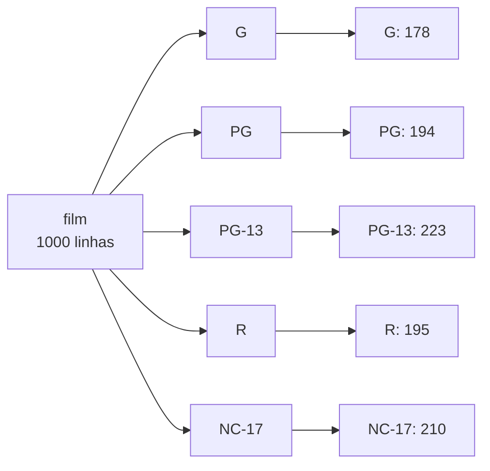

# SQL — Nível 3: Agregações

| Etapa | Arquivo | Tema |
|-------|---------|------|
| 0 | [my_sql_basics.md](my_sql_basics.md) | Fundamentos: banco, SGBD, cliente/servidor, ambiente com Docker e primeira conexão |
| 1 | [sql_comandos_1.md](sql_comandos_1.md) | Carregar o Sakila; investigar estruturas; criar, alterar e remover tabelas; inserir e editar dados |
| 2 | [sql_comandos_2.md](sql_comandos_2.md) | Consultas em uma tabela: `SELECT`, `DISTINCT`, `WHERE`, `LIKE`, `ORDER BY`, `LIMIT` |
| **3** | **[sql_comandos_3.md](sql_comandos_3.md)** | **Agregações: `COUNT`, `SUM`, `AVG`, `MIN`, `MAX`, `GROUP BY`, `HAVING` ← você está aqui** |
| 4 | [sql_comandos_4.md](sql_comandos_4.md) | Combinar tabelas: `INNER`, `LEFT`, `RIGHT` e `CROSS JOIN`, multiplicidade, `FULL` simulado |

> **Contrato deste arquivo**
>
> * **Objetivo:** resumir conjuntos de linhas em métricas e interpretar corretamente o que cada métrica mede.
> * **Conhecimentos prévios:** [nível 2](sql_comandos_2.md): `WHERE`, `NULL`, `ORDER BY` com desempate, `LIMIT`, ordem lógica.
> * **Estado inicial:** `sakila` no estado original. Execute `USE sakila;`.
> * **Ao final, você conseguirá:** (1) dizer o que uma linha representa antes e depois de agregar (**granularidade**); (2) escolher entre `COUNT(*)`, `COUNT(coluna)` e `COUNT(DISTINCT coluna)`; (3) prever o resultado de agregações com `NULL` e sem linhas; (4) agrupar por uma ou mais colunas ou expressões; (5) filtrar grupos com `HAVING` e explicar quando usar `WHERE`.
> * **Estado final:** nenhum dado é alterado (uma tabela `TEMPORARY` some ao desconectar).
> * **Próximo passo:** [nível 4](sql_comandos_4.md).

> Rótulos dos blocos: veja os [Fundamentos](my_sql_basics.md). Ambiente de referência: `mysql:8.0.45`, com o `sql_mode` padrão (que inclui `ONLY_FULL_GROUP_BY`). Todos os comandos rodam **no cliente MySQL**.

---

## 1. Problema

No nível 2, cada linha do resultado era uma linha da tabela. Muitas perguntas, porém, pedem um **resumo**:

| Pergunta | Tipo de resposta |
|----------|------------------|
| Quantos filmes há no catálogo? | Uma **contagem** |
| Quanto a locadora recebeu em pagamentos? | Uma **soma** |
| Qual o valor médio de um pagamento? | Uma **média** |
| Quantos filmes há **em cada** classificação? | Uma contagem **por grupo** |
| Quais clientes pagaram **mais de** 190 no total? | Um filtro **sobre os grupos** |

### 1.1 O que uma linha representa

Antes de agregar, pergunte sempre: **o que cada linha significa?**

| Consulta | Cada linha da **entrada** é... | Cada linha do **resultado** é... |
|----------|-------------------------------|----------------------------------|
| `SELECT SUM(amount) FROM payment` | um pagamento | o resumo de **todos** os pagamentos (1 linha) |
| `... FROM payment GROUP BY customer_id` | um pagamento | **um cliente** (o resumo dos pagamentos dele) |
| `... FROM film GROUP BY rating` | um filme | **uma classificação** |

Esse "nível de detalhe" de cada linha se chama **granularidade**. Agregar sempre muda a granularidade: de detalhada (pagamento) para resumida (cliente, ou tudo).

O SQL oferece três recursos:

1. **Funções de agregação**: transformam muitas linhas em um valor.
2. **`GROUP BY`**: separa as linhas em grupos antes de agregar.
3. **`HAVING`**: filtra os grupos depois de agregar.

---

## 2. Funções de agregação

### 2.1 As cinco principais

| Função | Calcula | Ignora `NULL`? |
|--------|---------|----------------|
| `COUNT(*)` | Quantidade de **linhas** | Não se aplica (conta linhas) |
| `COUNT(coluna)` | Quantidade de valores **não nulos** | Sim |
| `SUM(coluna)` | Soma | Sim |
| `AVG(coluna)` | Média | Sim |
| `MIN(coluna)` / `MAX(coluna)` | Menor / maior valor | Sim |

### 2.2 `COUNT`: três formas

**▶ Executar**

```sql
SELECT COUNT(*)                    AS filmes,
       COUNT(original_language_id) AS com_idioma_original,
       COUNT(DISTINCT rating)      AS classificacoes
FROM film;
```

```text
+--------+---------------------+----------------+
| filmes | com_idioma_original | classificacoes |
+--------+---------------------+----------------+
|   1000 |                   0 |              5 |
+--------+---------------------+----------------+
```

| Forma | Conta | Resultado |
|-------|-------|-----------|
| `COUNT(*)` | Todas as linhas | 1000 filmes |
| `COUNT(original_language_id)` | Linhas em que a coluna **não é `NULL`** | 0: nenhum filme tem idioma original informado |
| `COUNT(DISTINCT rating)` | Valores **diferentes**, ignorando `NULL` | 5 classificações |

Lembra da coluna `address2` (4 `NULL` e 599 textos vazios)?

**▶ Executar**

```sql
SELECT COUNT(*) AS enderecos, COUNT(address2) AS address2_nao_nulo FROM address;
```

```text
+-----------+-------------------+
| enderecos | address2_nao_nulo |
+-----------+-------------------+
|       603 |               599 |
+-----------+-------------------+
```

`COUNT(address2)` contou os 599 textos **vazios**, porque `''` não é `NULL`. Logo, 599 é a quantidade de valores **não nulos**, não de complementos de fato preenchidos (que são zero). Saber o que a métrica mede evita conclusões erradas.

### 2.3 `SUM`: somando

**▶ Executar**

```sql
SELECT SUM(amount) AS total_recebido FROM payment;
```

```text
+----------------+
| total_recebido |
+----------------+
|       67406.56 |
+----------------+
```

Neste curso, "total recebido" ou "faturamento" significa **a soma dos pagamentos registrados** na tabela `payment`, em unidades monetárias. Não é um conceito contábil completo.

Um truque que depende dos dados:

**▶ Executar**

```sql
SELECT COUNT(*) AS clientes, SUM(active) AS ativos FROM customer;
```

```text
+----------+--------+
| clientes | ativos |
+----------+--------+
|      599 |    584 |
+----------+--------+
```

`SUM(active)` conta os ativos **porque, nesta base, `active` contém apenas 0 e 1**. O tipo `BOOLEAN` não garante isso (nível 1, seção 11.1): se houvesse um `2`, a soma deixaria de ser uma contagem. A forma que não depende dessa hipótese é `SELECT COUNT(*) FROM customer WHERE active = 1;`.

### 2.4 `AVG`, `MIN`, `MAX` e `ROUND`

**▶ Executar**

```sql
SELECT AVG(amount) AS valor_medio_por_pagamento,
       MIN(amount) AS menor,
       MAX(amount) AS maior
FROM payment;
```

```text
+---------------------------+-------+-------+
| valor_medio_por_pagamento | menor | maior |
+---------------------------+-------+-------+
|                  4.201356 |  0.00 | 11.99 |
+---------------------------+-------+-------+
```

Atenção à granularidade: como cada linha de `payment` é **um pagamento**, essa é a média **por pagamento**. Não é o gasto médio **por cliente** (que exigiria somar por cliente antes, como na seção 3).

`ROUND(valor, casas)` arredonda o **resultado exibido**; os pagamentos armazenados não mudam:

**▶ Executar**

```sql
SELECT ROUND(AVG(amount), 2) AS valor_medio_por_pagamento FROM payment;
```

```text
+---------------------------+
| valor_medio_por_pagamento |
+---------------------------+
|                      4.20 |
+---------------------------+
```

`MIN` e `MAX` também funcionam com datas:

**▶ Executar**

```sql
SELECT MIN(payment_date) AS primeiro, MAX(payment_date) AS ultimo FROM payment;
```

```text
+---------------------+---------------------+
| primeiro            | ultimo              |
+---------------------+---------------------+
| 2005-05-24 22:53:30 | 2006-02-14 15:16:03 |
+---------------------+---------------------+
```

### 2.5 `NULL`, conjunto vazio e `COALESCE`

Um microexemplo completo, com uma tabela temporária de três valores (`10`, `NULL`, `20`):

**▶ Executar**

```sql
CREATE TEMPORARY TABLE notas (valor INT);
INSERT INTO notas VALUES (10), (NULL), (20);

SELECT COUNT(*)     AS linhas,
       COUNT(valor) AS valores,
       SUM(valor)   AS soma,
       AVG(valor)   AS media,
       MIN(valor)   AS menor
FROM notas;
```

```text
+--------+---------+------+---------+-------+
| linhas | valores | soma | media   | menor |
+--------+---------+------+---------+-------+
|      3 |       2 |   30 | 15.0000 |    10 |
+--------+---------+------+---------+-------+
```

O `NULL` foi ignorado: a média é (10 + 20) / **2** = 15, não 30 / 3 = 10.

Agora, um filtro que não encontra **nenhuma** linha (não há pagamento acima de 100):

**▶ Executar**

```sql
SELECT COUNT(*)                 AS n,
       SUM(amount)              AS soma,
       AVG(amount)              AS media,
       MAX(amount)              AS maior,
       COALESCE(SUM(amount), 0) AS soma_ou_zero
FROM payment
WHERE amount > 100;
```

```text
+---+------+-------+-------+--------------+
| n | soma | media | maior | soma_ou_zero |
+---+------+-------+-------+--------------+
| 0 | NULL |  NULL |  NULL |         0.00 |
+---+------+-------+-------+--------------+
```

| Situação | `COUNT` | `SUM`, `AVG`, `MIN`, `MAX` |
|----------|---------|-----------------------------|
| Há valores | Conta | Calcula ignorando `NULL` |
| Nenhuma linha (ou só `NULL`) | **0** | **`NULL`** ("não há o que somar") |

`COALESCE(a, b)` devolve o primeiro valor não nulo. Use-o quando **zero** for a resposta correta no domínio (uma soma de pagamentos inexistentes é 0), não para esconder `NULL` que significa "desconhecido".

Repare: uma agregação **sem** `GROUP BY` sempre devolve **uma** linha, mesmo sem dados. Com `GROUP BY`, se não houver linhas, não há grupos, e o resultado é **vazio**:

**▶ Executar**

```sql
SELECT customer_id, COUNT(*) FROM payment WHERE amount > 100 GROUP BY customer_id;
```

```text
Empty set
```

### 2.6 Agregando parte das linhas: `WHERE` + agregação

O `WHERE` filtra **antes** de agregar. Quanto foi recebido em julho de 2005?

**▶ Executar**

```sql
SELECT COUNT(*)    AS pagamentos,
       SUM(amount) AS total_recebido
FROM payment
WHERE payment_date >= '2005-07-01' AND payment_date < '2005-08-01';
```

```text
+------------+----------------+
| pagamentos | total_recebido |
+------------+----------------+
|       6709 |       28368.91 |
+------------+----------------+
```

### 2.7 Armadilha: `MAX` não seleciona a linha inteira

"Qual é o filme mais longo?"

**✖ Erro intencional**

```sql
SELECT title, MAX(length) FROM film;
```

```text
ERROR 1140 (42000): In aggregated query without GROUP BY, expression #1 of SELECT list contains nonaggregated column 'sakila.film.title'; this is incompatible with sql_mode=only_full_group_by
```

`MAX(length)` espreme 1000 linhas em **um** valor (185), mas `title` continua tendo 1000 valores. `MAX` devolve um **valor**, não "a linha onde ele está". Além disso, 10 filmes empatam com 185 minutos.

Para obter **um** filme com a maior duração, use o nível 2:

**▶ Executar**

```sql
SELECT title, length FROM film ORDER BY length DESC, title LIMIT 1;
```

```text
+---------------+--------+
| title         | length |
+---------------+--------+
| CHICAGO NORTH |    185 |
+---------------+--------+
```

Essa consulta escolhe **um** dos empatados, conforme o desempate (ordem alfabética). Para listar **todos** os de duração máxima, use `WHERE length = 185` (nível 2) ou uma subconsulta, que fica para depois do curso.

> **✅ Verifique.** Em `rental`, `return_date` é `NULL` para aluguéis em aberto. O que mede `COUNT(return_date)`? *Resposta:* a quantidade de aluguéis **devolvidos** (15861 de 16044).

---

## 3. `GROUP BY`: agregando por grupo

### 3.1 A ideia, com um recorte pequeno

Com `GROUP BY`, as linhas são separadas em **grupos** (uma "pilha" para cada valor), e a agregação é aplicada **em cada pilha**. Veja com os 8 primeiros filmes.

**Entrada:**

**▶ Executar**

```sql
SELECT film_id, rating
FROM film
WHERE film_id BETWEEN 1 AND 8
ORDER BY film_id;
```

```text
+---------+--------+
| film_id | rating |
+---------+--------+
|       1 | PG     |
|       2 | G      |
|       3 | NC-17  |
|       4 | G      |
|       5 | G      |
|       6 | PG     |
|       7 | PG-13  |
|       8 | R      |
+---------+--------+
```

**Separando em grupos (mentalmente):**

```text
G     → filmes 2, 4, 5
PG    → filmes 1, 6
PG-13 → filme 7
R     → filme 8
NC-17 → filme 3
```

**Agregando cada grupo:**

**▶ Executar**

```sql
SELECT rating, COUNT(*) AS filmes
FROM film
WHERE film_id BETWEEN 1 AND 8
GROUP BY rating
ORDER BY rating;
```

```text
+--------+--------+
| rating | filmes |
+--------+--------+
| G      |      3 |
| PG     |      2 |
| PG-13  |      1 |
| R      |      1 |
| NC-17  |      1 |
+--------+--------+
```

A granularidade mudou: cada linha agora é **uma classificação**, não um filme.

### 3.2 O catálogo inteiro

Retirando o filtro, a mesma lógica vale para os 1000 filmes:

**▶ Executar**

```sql
SELECT rating, COUNT(*) AS filmes
FROM film
GROUP BY rating
ORDER BY rating;
```

```text
+--------+--------+
| rating | filmes |
+--------+--------+
| G      |    178 |
| PG     |    194 |
| PG-13  |    223 |
| R      |    195 |
| NC-17  |    210 |
+--------+--------+
```



Duas observações:

* `GROUP BY` **não ordena**. Se a ordem importa, use `ORDER BY`.
* `rating` é um `ENUM`, e o `ORDER BY rating` segue a ordem em que a lista foi declarada (`'G','PG','PG-13','R','NC-17'`), não a ordem alfabética.

### 3.3 Várias agregações por grupo

**▶ Executar**

```sql
SELECT rating,
       COUNT(*)              AS filmes,
       ROUND(AVG(length), 1) AS duracao_media,
       MIN(length)           AS mais_curto,
       MAX(length)           AS mais_longo
FROM film
GROUP BY rating
ORDER BY rating;
```

```text
+--------+--------+---------------+------------+------------+
| rating | filmes | duracao_media | mais_curto | mais_longo |
+--------+--------+---------------+------------+------------+
| G      |    178 |         111.1 |         47 |        185 |
| PG     |    194 |         112.0 |         46 |        185 |
| PG-13  |    223 |         120.4 |         46 |        185 |
| R      |    195 |         118.7 |         49 |        185 |
| NC-17  |    210 |         113.2 |         46 |        184 |
+--------+--------+---------------+------------+------------+
```

Pagamentos registrados por funcionário (`staff_id`):

**▶ Executar**

```sql
SELECT staff_id, COUNT(*) AS pagamentos, SUM(amount) AS total_recebido
FROM payment
GROUP BY staff_id
ORDER BY staff_id;
```

```text
+----------+------------+----------------+
| staff_id | pagamentos | total_recebido |
+----------+------------+----------------+
|        1 |       8054 |       33482.50 |
|        2 |       7990 |       33924.06 |
+----------+------------+----------------+
```

### 3.4 Agrupando por uma expressão

`DATE_FORMAT(data, '%Y-%m')` transforma uma data em "ano-mês":

**▶ Executar**

```sql
SELECT DATE_FORMAT(payment_date, '%Y-%m') AS mes,
       COUNT(*)    AS pagamentos,
       SUM(amount) AS total_recebido
FROM payment
GROUP BY DATE_FORMAT(payment_date, '%Y-%m')
ORDER BY mes;
```

```text
+---------+------------+----------------+
| mes     | pagamentos | total_recebido |
+---------+------------+----------------+
| 2005-05 |       1156 |        4823.44 |
| 2005-06 |       2311 |        9629.89 |
| 2005-07 |       6709 |       28368.91 |
| 2005-08 |       5686 |       24070.14 |
| 2006-02 |        182 |         514.18 |
+---------+------------+----------------+
```

Só aparecem os meses que **têm** pagamentos: não há pagamentos **registrados na base** entre setembro de 2005 e janeiro de 2006. Isso é uma característica do conjunto de dados, não necessariamente da operação de uma locadora real.

**Observação:** o MySQL permite usar o apelido no `GROUP BY` (`GROUP BY mes`). É uma extensão do MySQL; repetir a expressão funciona em qualquer banco.

### 3.5 Agrupando por várias colunas

Com duas colunas, cada **combinação presente nos dados** vira um grupo:

**▶ Executar**

```sql
SELECT DATE_FORMAT(payment_date, '%Y-%m') AS mes,
       staff_id,
       SUM(amount) AS total_recebido
FROM payment
GROUP BY DATE_FORMAT(payment_date, '%Y-%m'), staff_id
ORDER BY mes, staff_id;
```

```text
+---------+----------+----------------+
| mes     | staff_id | total_recebido |
+---------+----------+----------------+
| 2005-05 |        1 |        2621.83 |
| 2005-05 |        2 |        2201.61 |
| 2005-06 |        1 |        4774.37 |
| 2005-06 |        2 |        4855.52 |
| 2005-07 |        1 |       13998.56 |
| 2005-07 |        2 |       14370.35 |
| 2005-08 |        1 |       11853.65 |
| 2005-08 |        2 |       12216.49 |
| 2006-02 |        1 |         234.09 |
| 2006-02 |        2 |         280.09 |
+---------+----------+----------------+
```

Aqui deu 10 grupos (5 meses × 2 funcionários) porque **cada funcionário registrou pagamentos em todos os meses**. Se um deles não tivesse registrado nada em fevereiro, aquela combinação simplesmente não apareceria.

### 3.6 Os maiores grupos

Os 5 clientes com maior total pago:

**▶ Executar**

```sql
SELECT customer_id, COUNT(*) AS pagamentos, SUM(amount) AS total
FROM payment
GROUP BY customer_id
ORDER BY total DESC, customer_id
LIMIT 5;
```

```text
+-------------+------------+--------+
| customer_id | pagamentos | total  |
+-------------+------------+--------+
|         526 |         45 | 221.55 |
|         148 |         46 | 216.54 |
|         144 |         42 | 195.58 |
|         137 |         39 | 194.61 |
|         178 |         39 | 194.61 |
+-------------+------------+--------+
```

Os clientes 137 e 178 empatam; o `customer_id` no `ORDER BY` desempata.

### 3.7 Uma convenção segura para o `SELECT`

> **Convenção para iniciantes:** no `SELECT` de uma consulta agrupada, coloque apenas **as colunas do `GROUP BY`** e **funções de agregação**.

**✖ Erro intencional**

```sql
SELECT customer_id, amount, SUM(amount)
FROM payment
GROUP BY customer_id;
```

```text
ERROR 1055 (42000): Expression #2 of SELECT list is not in GROUP BY clause and contains nonaggregated column 'sakila.payment.amount' which is not functionally dependent on columns in GROUP BY clause; this is incompatible with sql_mode=only_full_group_by
```

Cada cliente tem dezenas de pagamentos com valores diferentes. Qual `amount` mostrar na linha do cliente? Não há resposta, então o MySQL recusa. Corrija agregando (`MAX(amount)`, `SUM(amount)`...) ou repensando a pergunta.

**Nuance:** a regra que o MySQL realmente aplica é a de **dependência funcional**. Se o `GROUP BY` usa a chave primária, as outras colunas da mesma tabela são determinadas por ela, e o MySQL aceita:

**▶ Executar**

```sql
SELECT customer_id, first_name, last_name, COUNT(*) AS linhas
FROM customer
GROUP BY customer_id
ORDER BY customer_id
LIMIT 2;
```

```text
+-------------+------------+-----------+--------+
| customer_id | first_name | last_name | linhas |
+-------------+------------+-----------+--------+
|           1 | MARY       | SMITH     |      1 |
|           2 | PATRICIA   | JOHNSON   |      1 |
+-------------+------------+-----------+--------+
```

A convenção continua sendo a escolha mais segura. Nunca desative o `ONLY_FULL_GROUP_BY` para "fazer o erro sumir": ele está evitando resultados arbitrários.

---

## 4. `HAVING`: filtrando grupos

### 4.1 O problema

"Quais clientes pagaram **mais de 190** no total?" O total só existe **depois** do agrupamento, e o `WHERE` roda **antes**:

**✖ Erro intencional**

```sql
SELECT customer_id, SUM(amount) AS total
FROM payment
WHERE total > 190
GROUP BY customer_id;
```

```text
ERROR 1054 (42S22): Unknown column 'total' in 'where clause'
```

(E `WHERE SUM(amount) > 190` também não funcionaria: o `WHERE` avalia uma linha por vez, e ainda não há soma.)

### 4.2 A solução

O `HAVING` filtra **grupos**, depois do `GROUP BY`:

**▶ Executar**

```sql
SELECT customer_id, SUM(amount) AS total
FROM payment
GROUP BY customer_id
HAVING SUM(amount) > 190
ORDER BY total DESC, customer_id;
```

```text
+-------------+--------+
| customer_id | total  |
+-------------+--------+
|         526 | 221.55 |
|         148 | 216.54 |
|         144 | 195.58 |
|         137 | 194.61 |
|         178 | 194.61 |
+-------------+--------+
```

O MySQL também aceita o apelido no `HAVING` (`HAVING total > 190`). Isso é uma **extensão do MySQL**, coerente com o nível 2 apenas porque o MySQL abre essa exceção; em outros bancos, repita a agregação. Neste curso, preferimos a forma com a agregação.

Classificações cuja duração média passa de 115 minutos:

**▶ Executar**

```sql
SELECT rating, ROUND(AVG(length), 1) AS duracao_media
FROM film
GROUP BY rating
HAVING AVG(length) > 115
ORDER BY rating;
```

```text
+--------+---------------+
| rating | duracao_media |
+--------+---------------+
| PG-13  |         120.4 |
| R      |         118.7 |
+--------+---------------+
```

### 4.3 `WHERE` × `HAVING`

A diferença é de **significado**:

| | `WHERE` | `HAVING` |
|---|---------|----------|
| Pergunta que responde | "Quais **linhas** entram no cálculo?" | "Quais **grupos** aparecem no resultado?" |
| Momento lógico | Antes do `GROUP BY` | Depois do `GROUP BY` |
| Pode usar agregações? | Não | Sim |
| Exemplo | `WHERE payment_date >= '2005-07-01'` | `HAVING SUM(amount) > 190` |

As duas na mesma consulta: clientes que pagaram mais de 95 **considerando só julho de 2005**:

**▶ Executar**

```sql
SELECT customer_id, COUNT(*) AS pagamentos, SUM(amount) AS total
FROM payment
WHERE payment_date >= '2005-07-01' AND payment_date < '2005-08-01'
GROUP BY customer_id
HAVING SUM(amount) > 95
ORDER BY total DESC, customer_id;
```

```text
+-------------+------------+--------+
| customer_id | pagamentos | total  |
+-------------+------------+--------+
|         148 |         22 | 100.78 |
|         470 |         17 |  96.83 |
|         522 |         18 |  96.82 |
|         137 |         19 |  96.81 |
+-------------+------------+--------+
```

| Etapa lógica | Cláusula | O que sobra |
|--------------|----------|-------------|
| 1 | `FROM payment` | 16044 pagamentos |
| 2 | `WHERE` julho de 2005 | 6709 pagamentos |
| 3 | `GROUP BY customer_id` | Um grupo por cliente que pagou em julho |
| 4 | `HAVING SUM(amount) > 95` | 4 clientes |
| 5 | `ORDER BY total DESC, customer_id` | Os 4, do maior para o menor |

Trocar o `WHERE` por um `HAVING` mudaria a pergunta: "julho" é uma condição sobre **pagamentos**, não sobre clientes. Use `WHERE` quando a condição vale para cada linha; use `HAVING` quando ela depende de um resultado agregado. (Se uma forma é mais rápida que a outra depende do plano escolhido pelo otimizador; o critério aqui é o significado.)

---

## 5. A ordem lógica completa

| Ordem de escrita | Ordem lógica | O que acontece |
|------------------|--------------|----------------|
| `SELECT [DISTINCT] ...` | 1. `FROM` | Escolhe a tabela |
| `FROM ...` | 2. `WHERE` | Filtra as **linhas** |
| `WHERE ...` | 3. `GROUP BY` | Forma os grupos |
| `GROUP BY ...` | 4. `HAVING` | Filtra os **grupos** |
| `HAVING ...` | 5. `SELECT` | Calcula as colunas e os apelidos |
| `ORDER BY ...` | 6. `DISTINCT` | Remove repetições |
| `LIMIT ...` | 7. `ORDER BY` | Ordena |
| | 8. `LIMIT` | Corta |


Como no nível 2, esta é a ordem **lógica**: o otimizador pode executar de outro modo, com o mesmo resultado.

---

## 6. Juntando tudo

**Pergunta:** "Entre os clientes com **pelo menos 40 pagamentos de valor positivo**, quais são os 5 que mais pagaram?"

**▶ Executar**

```sql
SELECT customer_id,
       COUNT(*)    AS pagamentos_positivos,
       SUM(amount) AS total
FROM payment
WHERE amount > 0
GROUP BY customer_id
HAVING COUNT(*) >= 40
ORDER BY total DESC, customer_id
LIMIT 5;
```

```text
+-------------+----------------------+--------+
| customer_id | pagamentos_positivos | total  |
+-------------+----------------------+--------+
|         526 |                   45 | 221.55 |
|         148 |                   46 | 216.54 |
|         144 |                   42 | 195.58 |
|         469 |                   40 | 177.60 |
|         236 |                   42 | 175.58 |
+-------------+----------------------+--------+
```

| Cláusula | Papel |
|----------|-------|
| `FROM payment` | Cada linha é um pagamento (16044) |
| `WHERE amount > 0` | Descarta os 24 pagamentos de valor zero (ficam 16020) |
| `GROUP BY customer_id` | Cada linha passa a ser um cliente |
| `HAVING COUNT(*) >= 40` | Mantém clientes com 40 ou mais pagamentos **positivos** |
| `ORDER BY total DESC, customer_id` | Do maior total para o menor, com desempate |
| `LIMIT 5` | Os 5 primeiros |

O `COUNT(*)` conta pagamentos **que passaram pelo `WHERE`**. Se a pergunta fosse "pelo menos 40 pagamentos de qualquer valor", sem o `WHERE`, o cliente 75 (41 pagamentos, dos quais 2 de valor zero) também entraria no grupo dos frequentes. Mudar o filtro muda a pergunta.

---

## 7. Aprofundamentos (opcionais)

### 7.1 `GROUP_CONCAT`: os valores do grupo em um texto

Sobrenomes compartilhados por 4 ou mais atores, com os primeiros nomes:

**▶ Executar**

```sql
SELECT last_name,
       COUNT(*) AS atores,
       GROUP_CONCAT(first_name ORDER BY first_name SEPARATOR ', ') AS nomes
FROM actor
GROUP BY last_name
HAVING COUNT(*) >= 4
ORDER BY atores DESC, last_name;
```

```text
+-----------+--------+-----------------------------------+
| last_name | atores | nomes                             |
+-----------+--------+-----------------------------------+
| KILMER    |      5 | FAY, MINNIE, OPRAH, REESE, SANDRA |
| NOLTE     |      4 | ALBERT, JAYNE, SALMA, WARREN      |
| TEMPLE    |      4 | BURT, MENA, RUSSELL, THORA        |
+-----------+--------+-----------------------------------+
```

* O `ORDER BY` **dentro** do `GROUP_CONCAT` ordena os nomes no texto; sem ele, a ordem não é garantida.
* O texto tem limite de tamanho (`group_concat_max_len`, 1024 bytes por padrão). Textos maiores são **cortados** com apenas um aviso.

### 7.2 `WITH ROLLUP`: subtotal geral

**▶ Executar**

```sql
SELECT store_id, GROUPING(store_id) AS eh_total, COUNT(*) AS clientes
FROM customer
GROUP BY store_id WITH ROLLUP;
```

```text
+----------+----------+----------+
| store_id | eh_total | clientes |
+----------+----------+----------+
|        1 |        0 |      326 |
|        2 |        0 |      273 |
|     NULL |        1 |      599 |
+----------+----------+----------+
```

A última linha é o total de todas as lojas. O `NULL` em `store_id` ali **não** é um dado ausente: é a marca do subtotal. Como uma coluna de dados também pode conter `NULL` de verdade, `GROUPING(coluna)` desfaz a ambiguidade: vale `1` na linha de subtotal e `0` nas demais.

### 7.3 Analogia com MapReduce

Se você estudou [sistemas distribuídos](../sistemas-distribuidos/1_sistemas_distribuidos.md), há uma **analogia** útil: separar as linhas por chave lembra o *shuffle*, e calcular o resultado de cada grupo lembra o *reduce*. É apenas uma comparação de ideias; o MySQL não executa um `GROUP BY` como um job MapReduce.

---

## 8. Resumindo

| Recurso | Para quê | Exemplo |
|---------|----------|---------|
| `COUNT(*)` | Contar linhas | `SELECT COUNT(*) FROM film` |
| `COUNT(col)` | Contar valores não nulos | `COUNT(return_date)` |
| `COUNT(DISTINCT col)` | Contar valores diferentes | `COUNT(DISTINCT rating)` |
| `SUM`, `AVG`, `MIN`, `MAX` | Somar, média, menor, maior (ignoram `NULL`) | `SUM(amount)` |
| `ROUND(x, n)` | Arredondar o resultado exibido | `ROUND(AVG(amount), 2)` |
| `COALESCE(x, 0)` | Trocar `NULL` por zero quando fizer sentido | `COALESCE(SUM(amount), 0)` |
| `GROUP BY` | Agregar por grupo (não ordena) | `GROUP BY rating` |
| `HAVING` | Filtrar grupos | `HAVING SUM(amount) > 190` |

Repare na saída da seção 6: ela mostra `customer_id = 526`, mas **quem** é esse cliente? O nome está em outra tabela (`customer`), assim como o título do filme está em `film` e o nome da categoria em `category`. Para combinar tabelas, precisamos do `JOIN`.

---

## 9. Exercícios

1. **Granularidade.** Em `SELECT customer_id, COUNT(*) FROM rental GROUP BY customer_id;`, o que cada linha do resultado representa? Quantas linhas você espera, sabendo que há 599 clientes e todos alugaram ao menos uma vez?
2. **`COUNT` com `NULL`.** Calcule, numa só consulta, o total de aluguéis e quantos já foram devolvidos.
3. **`HAVING`.** Para cada `rental_duration` (prazo de aluguel, em dias), mostre a duração média dos filmes arredondada a 1 casa, só para os prazos cuja média passa de 115 minutos.
4. **Agrupar por expressão.** Em que mês (`ano-mês`) houve mais aluguéis? Use desempate.
5. **Depuração.** Por que `SELECT staff_id, payment_date, SUM(amount) FROM payment GROUP BY staff_id;` falha? Proponha uma correção que mostre a data do último pagamento de cada funcionário.
6. **Interpretação.** O resultado por mês da seção 3.4 não tem linhas entre 2005-09 e 2006-01. Isso prova que a locadora ficou fechada?

<details>
<summary><strong>Gabarito comentado</strong></summary>

**1.** Cada linha é **um cliente** (com a quantidade de aluguéis dele). Esperam-se **599** linhas, uma por cliente com aluguéis.

**2.**

```sql
SELECT COUNT(*) AS alugueis, COUNT(return_date) AS devolvidos FROM rental;
```

16044 aluguéis, 15861 devolvidos. `COUNT(return_date)` ignora os 183 `NULL` (em aberto).

**3.**

```sql
SELECT rental_duration, ROUND(AVG(length), 1) AS duracao_media
FROM film
GROUP BY rental_duration
HAVING AVG(length) > 115
ORDER BY rental_duration;
```

Prazos 5 (116.6), 6 (117.0) e 7 (118.8). A condição é sobre a **média do grupo**, então vai no `HAVING`.

**4.**

```sql
SELECT DATE_FORMAT(rental_date, '%Y-%m') AS mes, COUNT(*) AS alugueis
FROM rental
GROUP BY DATE_FORMAT(rental_date, '%Y-%m')
ORDER BY alugueis DESC, mes
LIMIT 1;
```

2005-07, com 6709 aluguéis.

**5.** `payment_date` não está no `GROUP BY` nem agregada: cada funcionário tem milhares de datas (erro 1055). Correção:

```sql
SELECT staff_id, MAX(payment_date) AS ultimo_pagamento, SUM(amount) AS total
FROM payment
GROUP BY staff_id;
```

**6.** **Não.** Prova apenas que **não há pagamentos registrados na base** nesse intervalo. O conjunto de dados pode ter sido gerado ou recortado assim. Conclusões sobre o negócio exigem informação fora da tabela.

</details>

> **Próximo passo:** o [nível 4](sql_comandos_4.md) ensina a combinar tabelas com `JOIN`, começando por descobrir quem é o cliente 526.
