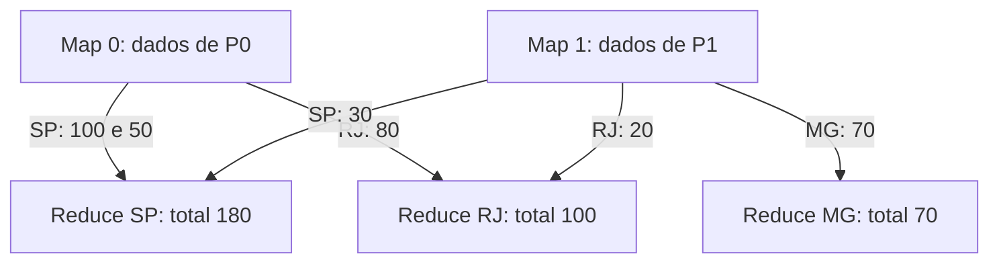
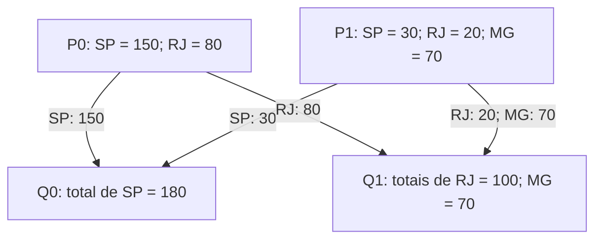

# Sistemas Distribuídos

## 1. Problema

Imagine uma empresa com bilhões de registros de vendas e você precisa calcular quanto ela vendeu em cada estado do país.

### 1.1 Em SQL

```sql
SELECT nome, SUM(valor)
FROM vendas
GROUP BY nome;
```

Quem executa o processamento dessa query é a CPU do servidor que está executando o programa do banco de dados, por exemplo o MySQL Server.

| Componente             | Papel na execução da consulta |
|------------------------|-------------------------------|
| MySQl Server (SGBD)    | Recebe a query, interpreta e coordena operações |
| CPU (Processador)      | Executa as intruções recebidas pelo MySQL Server |
| RAM (Memória)          | Mantém dados acessados e estruturas temporárias usadas no processamento |
| SSD/HD (Armazenamento) | Guarda Arquivos persistentes que contêm dados e índices |
| Sistema Operacional    | Gerencia os recursos e atende solicitações de acesso a arquivos e comunicação |

### 1.2 O questionamento

Como executar isso quando os dados são grandes demais para serem processados com eficiência em uma única máquina?

Temos duas possibilidades:

* **Escalar Verticalmente:** Usar uma máquina com mais CPU, memória e capacidade de armazenamento
* **Escalar Horizontalmente:** Distribuir o trabalho

### 1.3 Novos problemas da distribuição

**Spark e MapReduce** foram desenvolvidos para explorar essa segunda possibilidade. Entretanto, dividir o trabalho em diferentes máquinas cria novos problemas:

* Qual máquina processará cada parte?
* Como combinar resultados produzidos em diferentes lugares?
* O que fazer se uma máquina falhar?

> Processamento distribuído envolve tanto calcular quanto organizar onde os cálculos e os dados estarão.

---

## 2. Partições

### 2.1 Definição

Uma partição é uma parte lógica de um conjunto de dados. Uma partição não corresponde obrigatoriamente a uma máquina ou a um arquivo.

### 2.2 Exemplo

Considere estas vendas, com valores inteiros em reais para simplificar:

| Venda | Estado | Valor |
|-------|--------|-------|
| 1     | SP     | 100   |
| 2     | RJ     | 80    |
| 3     | SP     | 50    |
| 4     | RJ     | 20    |
| 5     | MG     | 70    |
| 6     | SP     | 30    |

Podemos dividir esse conjunto de dados em partições:

| Partição | Registros                |
|----------|--------------------------|
| P0       | SP: 100; RJ: 80; SP: 50  |
| P1       | RJ: 20; MG: 70; SP: 30   |

### 2.3 A limitação

Agora duas unidades de processamento podem trabalhar simutaneamente: uma processa o P0 e outra processa P1.

Mas observe que as vendas de SP estão espalhadas pelas duas partições. Cada uma consegue calcular uma parte do resultado, porém nenhuma conhece, sozinha, o total de SP.

> Essa dificuldade é o ponto de partida para entender **MapReduce**.

---

## 3. MapReduce

### 3.1 Definição

MapReduce é um modelo de programação, e também o nome dos frameworks que o implementam, para processar grandes volumes de dados em paralelo em um cluster. O framework cuida de dividir a entrada, distribuir as tarefas, agrupar os resultados intermediários e reexecutar as tarefas que falham.

### 3.2 Etapas

Embora o nome cite duas operações, o fluxo tem três etapas:

| Momento | Responsabilidade                           | Quem implementa |
|---------|--------------------------------------------|-----------------|
| Map     | Transformar registro em pares chaves-valor | Programador     |
| Shuffle | Reunir os dados associados à mesma chave   | Framework       |
| Reduce  | Processar os valores em cada chave         | Programador     |

### 3.3 Exemplo passo a passo

#### Map

Cada venda vira um par (estado, valor).

**Antes:**

```python
(1, "SP", 100)
```

**Depois:**

```python
("SP", 100)
```

#### Shuffle

Os pares são reorganizados pela chave.

**Antes:**

```python
P0 = [("SP", 100), ("RJ", 80), ("SP", 50)]
P1 = [("RJ", 20), ("MG", 70), ("SP", 30)]
```

**Depois:**

```python
"SP": [100, 50, 30]
"RJ": [80, 20]
"MG": [70]
```

#### Reduce

Calculamos o resultado de cada grupo.

**Antes:**

```python
"SP": [100, 50, 30]
"RJ": [80, 20]
"MG": [70]
```

**Depois:**

| Estado | Total |
|--------|-------|
| SP     | 180   |
| RJ     | 100   |
| MG     | 70    |

### 3.4 Resumindo



* **Caixas superiores:** representam o processamento das duas partições de entrada. Cada **`map`** aplica a função mapear aos registros da sua partição, produzindo pares como `("SP", 100)`.
* **Setas:** representam o **`shuffle`** (encaminhar os pares para reunir os dados do mesmo estado).
* **Caixas inferiores:** representam a aplicação do reduce a cada grupo.

Por fim, observe que os valores de SP vieram de duas partições diferentes, mas precisam ser combinados para calcular o total.

**Observação:** O shuffle é uma das partes mais importantes e mais caras.

Somar 100 + 50 é uma operação muito barata.

Levar milhões de registros de uma máquina para outra pode exigir:
- Serialização: converter dados para uma representação transportável.
- Transferência pela rede.
- Escrita e leitura de arquivos intermediários.
- Organização dos registros por chave.
- Memória para estruturas de agregação.

## 4. Spark 

### 4.1 Definição

Trata-se de um motor de processamento de dados. O Apache Spark é um software que consegue executar esse tipo de processamento em paralelo, utilizando os recursos de várias máquinas. Você pode escrever as operações em Python, SQL, Scala e outras linguagens.

### 4.2 Cluster

> Um cluster reúne máquinas; o Spark distribui tarefas entre elas.

Um cluster é um conjunto de máquinas trabalhando de maneira coordenada. Cada máquina tem seus próprios recursos de CPU, RAM e armazenamento.

#### Componentes de uma aplicação Spark

Na arquitetura tradicional de uma aplicação Spark, estes são os principais componentes:

| Componente      | Papel |
|-----------------|-------|
| Driver          | Executa o programa principal, coordena o processamento e agenda tarefas |
| Worker node     | Máquina que disponibiliza recursos para executar trabalho |
| Executor        | Processo que executa tarefas e mantém dados intermediários |
| Cluster manager | Aloca recursos do cluster para as aplicações |

**Worker × Executor:** worker é uma máquina; executor é um processo executado nela. Uma máquina pode hospedar mais de um executor, conforme a configuração. *(Fonte: Spark 4.3.0 Documentation)*

#### Aplicando ao exemplo

* Um executor pode processar a partição P0.
* Outro pode processar a partição P1.
* As CPUs das máquinas executam os cálculos dessas tarefas.

As partições não precisam ter uma máquina exclusiva. Imagine 100 caixas para uma equipe de quatro pessoas: cada pessoa termina uma caixa e pega outra. Da mesma forma, um executor pode processar várias partições ao longo da execução.

### 4.3 DataFrame

> Um DataFrame apresenta os dados como uma tabela, mesmo quando eles estão distribuídos.

O DataFrame é uma das principais estruturas usadas para trabalhar com dados no Spark. Ele organiza os dados em linhas e colunas com nomes e tipos. *(Fonte: Spark 4.3.0 Documentation)*

#### Visão lógica × execução

No exemplo, você enxerga uma única tabela:

| venda | estado | valor |
|-------|--------|-------|
| 1     | SP     | 100   |
| 2     | RJ     | 80    |
| 3     | SP     | 50    |
| 4     | RJ     | 20    |
| 5     | MG     | 70    |
| 6     | SP     | 30    |

Entretanto, para processá-la, o Spark pode trabalhar com uma divisão como:

| Partição | Registros       |
|----------|-----------------|
| P0       | Vendas 1, 2 e 3 |
| P1       | Vendas 4, 5 e 6 |

> Você escreve operações sobre o DataFrame inteiro; a execução trabalha sobre suas partições.

Essa separação ajuda bastante: para pedir uma soma por estado, você não precisa escrever manualmente o código de comunicação entre as máquinas.

### 4.4 PySpark

> Com PySpark, você descreve essas operações usando Python.

PySpark é a interface Python do Spark.

#### Exemplo

Veja um exemplo com os dados de vendas, supondo um ambiente com PySpark configurado:

```python
from pyspark.sql import SparkSession
from pyspark.sql import functions as F

spark = (
    SparkSession.builder
    .appName("Vendas por estado")
    .master("local[2]")
    .getOrCreate()
)

dados = [
    (1, "SP", 100),
    (2, "RJ", 80),
    (3, "SP", 50),
    (4, "RJ", 20),
    (5, "MG", 70),
    (6, "SP", 30),
]

vendas = spark.createDataFrame(
    dados,
    schema="venda INT, estado STRING, valor INT"
)

totais = vendas.groupBy("estado").agg(
    F.sum("valor").alias("total")
)

totais.show()
```

* **`SparkSession`:** guardada na variável `spark`, é o ponto de entrada para criar DataFrames e trabalhar com Spark SQL. *(Fonte: Spark 4.3.0 Documentation)*
* **`local[2]`:** permite estudar na própria máquina, usando duas threads de execução para as tarefas. Ela não cria duas máquinas. *(Fonte: Spark 4.3.0 Documentation)*

#### Lendo a operação principal

```python
totais = vendas.groupBy("estado").agg(
    F.sum("valor").alias("total")
)
```

Leia assim:

| Trecho               | Significado |
|----------------------|-------------|
| `vendas`             | Conjunto de dados de entrada |
| `.groupBy("estado")` | Define o agrupamento por estado |
| `.agg(...)`          | Define o cálculo para cada grupo |
| `F.sum("valor")`     | Soma os valores |
| `.alias("total")`    | Dá à coluna resultante o nome `total` |

O resultado esperado contém estas linhas, cuja ordem pode variar:

| estado | total |
|--------|-------|
| SP     | 180   |
| RJ     | 100   |
| MG     | 70    |

#### A mesma consulta em SQL

```python
vendas.createOrReplaceTempView("vendas")

totais = spark.sql("""
    SELECT estado, SUM(valor) AS total
    FROM vendas
    GROUP BY estado
""")

totais.show()
```

A primeira linha registra o DataFrame como uma visão temporária chamada `vendas`. A consulta é processada pelo Spark. *(Fonte: Spark 4.3.0 Documentation)*

**Observação:** usamos uma lista Python porque existem apenas seis vendas. Para grandes volumes, normalmente o Spark lê os dados diretamente de uma fonte de armazenamento, como arquivos Parquet.

### 4.5 Avaliação preguiçosa (lazy evaluation)

> O Spark distingue descrever uma operação de pedir sua execução.

Observe esta linha novamente:

```python
totais = vendas.groupBy("estado").agg(
    F.sum("valor").alias("total")
)
```

Ela define como produzir os totais, mas não calcula imediatamente toda a agregação.

O Spark registra as operações necessárias. Quando você pede um resultado, ele executa o processamento correspondente. Esse comportamento é chamado de **avaliação preguiçosa**, ou **lazy evaluation**. *(Fonte: PySpark 4.3.0 documentation)*

Pense em montar uma receita: primeiro você organiza os passos; depois começa a prepará-la.

#### Transformações × ações

| Categoria     | Ideia | Exemplos |
|---------------|-------|----------|
| Transformação | Define um novo conjunto de dados a partir de outro | `filter()`, `select()`, `groupBy(...).agg(...)` |
| Ação          | Solicita um resultado e dispara o processamento necessário | `show()`, `count()`, escrita de resultados |

No nosso código:

```python
# Define o cálculo.
totais = vendas.groupBy("estado").agg(
    F.sum("valor").alias("total")
)

# Solicita a exibição do resultado.
totais.show()
```

#### Por que isso importa

Isso permite ao Spark analisar a sequência de operações antes de executá-la. Por exemplo, ele pode identificar quais colunas realmente serão necessárias para a consulta.

**Observação:** a regra se refere ao cálculo das transformações. Atividades de preparação, como descobrir o esquema de uma fonte, podem exigir trabalho antes de uma ação.

### 4.6 Agregação parcial antes do shuffle

> Na soma por estado, o Spark pode somar localmente antes do shuffle.

Vamos retomar exatamente as partições do exemplo. Essa divisão será uma ilustração; o número e a distribuição das partições em uma execução real dependem da configuração e do plano.

```python
P0 = [("SP", 100), ("RJ", 80), ("SP", 50)]
P1 = [("RJ", 20), ("MG", 70), ("SP", 30)]
```

Para uma soma por chave, um plano comum combina **agregação parcial**, **shuffle** e **agregação final**. *(Fonte: Spark 3.5.6 Documentation)*

#### Passo 1: calcular subtotais dentro de cada partição

Em P0, já podemos somar as duas vendas de SP:

```text
100 + 50 = 150
```

Assim, os resultados parciais ficam:

| Origem | Subtotais              |
|--------|------------------------|
| P0     | SP: 150; RJ: 80        |
| P1     | RJ: 20; MG: 70; SP: 30 |

#### Passo 2: redistribuir os subtotais pela chave

Os valores referentes a SP precisam chegar ao mesmo destino para a soma final. O mesmo vale para RJ e MG.

Uma distribuição possível seria:



As setas representam o shuffle. As caixas inferiores representam o processamento das partições de destino.

#### Passo 3: combinar os subtotais recebidos

| Estado | Cálculo final | Total |
|--------|---------------|-------|
| SP     | 150 + 30      | 180   |
| RJ     | 80 + 20       | 100   |
| MG     | 70            | 70    |

#### Consequências

* Uma partição de destino pode conter vários estados. No desenho, Q1 processa RJ e MG.
* A soma local pode reduzir bastante os dados transferidos. Se uma partição tiver um milhão de vendas de SP, pode produzir um subtotal para SP antes da troca de dados.

**Observação:** essa agregação local também existe no Hadoop MapReduce por meio de um **combiner**. Ela é uma otimização aplicável a operações como a soma. *(Fonte: MapReduce Tutorial)*

### 4.7 Jobs, stages e tasks

> Jobs, stages e tasks são maneiras de organizar esse trabalho.

Esses nomes aparecem com frequência quando você acompanha uma execução:

| Termo | Significado básico |
|-------|--------------------|
| Job   | Trabalho de processamento disparado em resposta a uma ação |
| Stage | Etapa do trabalho composta por tarefas |
| Task  | Unidade de trabalho enviada a um executor |

Uma ação pode desencadear um ou mais jobs, dependendo da execução. Cada job é dividido em stages e tasks. *(Fonte: Spark 4.3.0 Documentation)*

#### Aplicando ao exemplo

No processamento ilustrado, podemos pensar em dois grandes stages separados pelo shuffle:

| Etapa             | Trabalho |
|-------------------|----------|
| Antes do shuffle  | Processar P0 e P1 e produzir os subtotais |
| Depois do shuffle | Processar Q0 e Q1 e combinar os subtotais |

Em uma etapa, cada task trabalha sobre uma partição. Assim, as tarefas de P0 e P1 podem executar em paralelo, se houver recursos disponíveis. *(Fonte: Spark 4.3.0 Documentation)*

Uma mesma task pode executar várias operações encadeadas, como filtrar registros e calcular subtotais.

### 4.8 Cache

> O Spark pode guardar dados intermediários para reutilizá-los.

Imagine que, depois de preparar as vendas, você queira calcular:

* Total vendido por estado.
* Quantidade de vendas por estado.
* Valor médio por estado.

Essas análises compartilham os mesmos dados de entrada. Pode ser útil guardar o resultado da preparação para reutilizá-lo. Esse mecanismo é chamado de **cache**. *(Fonte: Spark 4.3.0 Documentation)*

#### Exemplo

```python
vendas_validas = vendas.filter(F.col("valor") > 0)
vendas_validas.cache()

vendas_validas.groupBy("estado").agg(
    F.sum("valor").alias("total")
).show()

vendas_validas.groupBy("estado").agg(
    F.avg("valor").alias("media")
).show()
```

O cache vai sendo preenchido conforme as partições são calculadas. A análise seguinte pode reutilizar esses dados.

#### Memória e disco

A memória dos executores ajuda nessa reutilização, mas o Spark também utiliza disco. O cache padrão de DataFrames admite memória e disco, e o shuffle também pode envolver arquivos intermediários. *(Fonte: PySpark 4.3.0 documentation)*

Portanto, não é necessário imaginar todos os bilhões de registros carregados simultaneamente na RAM. O processamento acontece por partições, e o uso dos recursos depende das operações e da configuração.

### 4.9 Tolerância a falhas

> Se uma tarefa falhar, o Spark pode refazer o trabalho necessário.

Considere uma falha enquanto um executor processa P1:

1. A tarefa de P1 não termina.
2. O Spark detecta a falha e pode agendar uma nova tentativa.
3. Outro executor pode ler novamente os dados necessários.
4. Os resultados perdidos podem ser reconstruídos.

O Spark mantém as dependências entre os cálculos — uma espécie de histórico de como produzir cada resultado. Isso permite recomputar partições perdidas. *(Fonte: Spark 4.3.0 Documentation)*

No exemplo, reconstruir o subtotal de SP em P1 significa voltar aos dados dessa partição e calcular novamente seu valor, 30.

**Observação:** essa recuperação pressupõe que os dados de origem continuem acessíveis e que existam recursos para repetir o trabalho. Ela pode exigir recomputar etapas anteriores, dependendo do que foi perdido.
